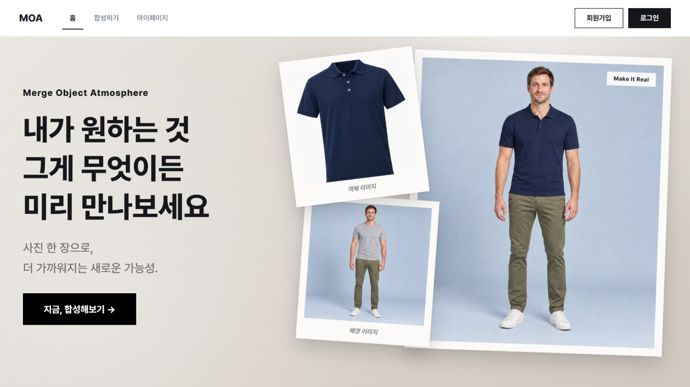
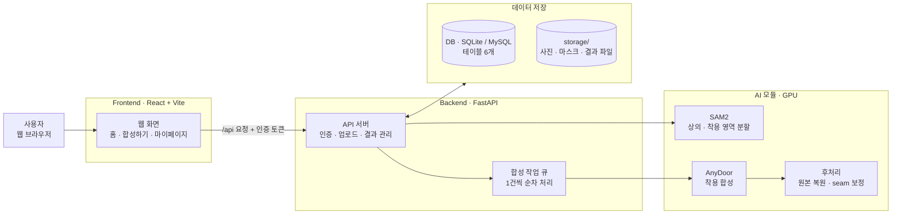
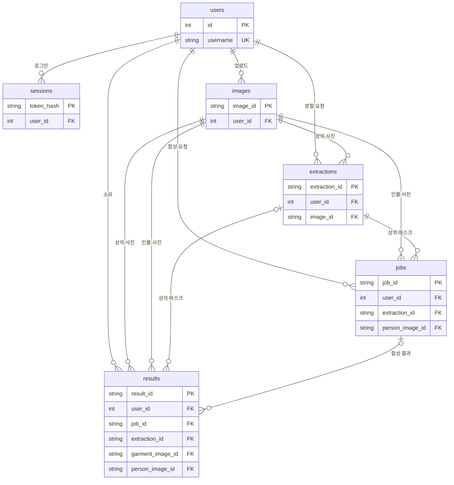
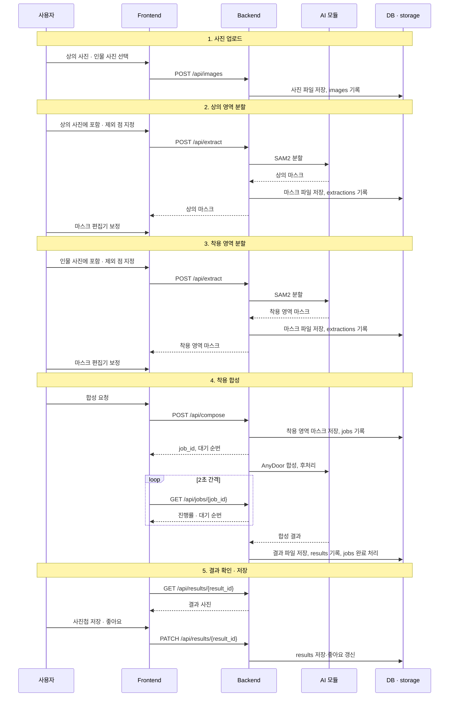
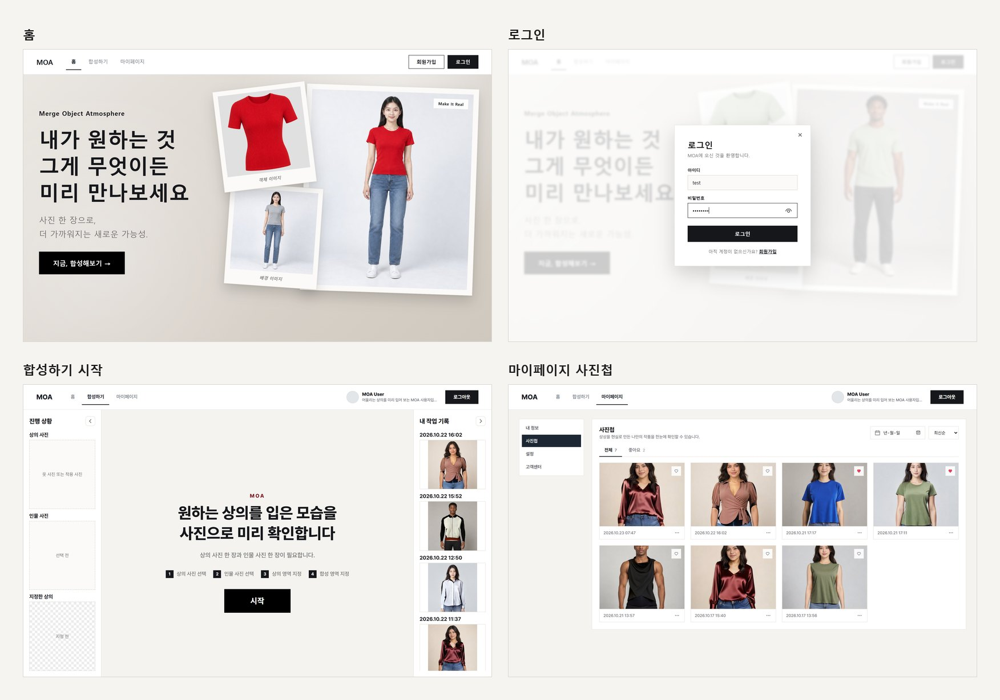
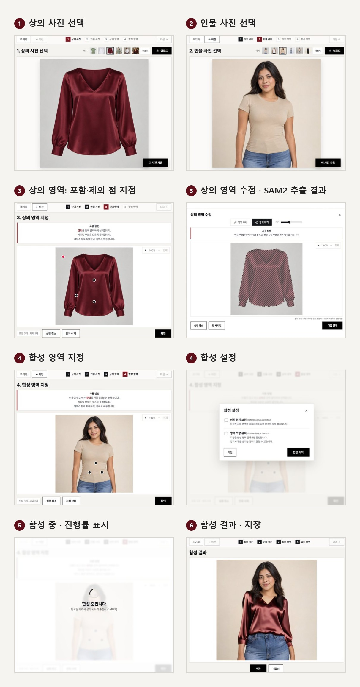

<div align="center">

# MOA

### AI 기반 상의 착용 합성 웹 서비스

SAM2 영역 분할 · AnyDoor 합성 기반 상의 가상 피팅

**4인 팀 프로젝트**

`React + Vite` · `FastAPI` · `SQLite / MySQL` · `SAM2` · `AnyDoor` · `PyTorch`

<br>



</div>

---

## 목차

1. [프로젝트 개요](#1-프로젝트-개요)
2. [서비스 구조](#2-서비스-구조)
3. [처리 흐름](#3-처리-흐름)
4. [구현 화면](#4-구현-화면)
5. [기능](#5-기능)
6. [문제 해결](#6-문제-해결)
7. [설치 및 실행](#7-설치-및-실행)
8. [디렉터리 구성](#8-디렉터리-구성)
9. [관련 문서](#9-관련-문서)
10. [참고 자료](#10-참고-자료)

---

## 1. 프로젝트 개요

| 항목 | 내용 |
|---|---|
| **배경** | 온라인 의류 구매 증가, 직접 입어 보지 않은 상태의 구매 결정 |
| **문제** | 모델 착용 사진과 본인 착용 모습의 차이<br>구매 후 기대와 다른 색감·분위기로 인한 반품·교환<br>반품·교환 과정의 시간·배송비 부담 |
| **목적** | 구매 전 본인 사진 기반 착용 모습 확인<br>구매 판단 지원, 반품·교환 부담 감소 |
| **기능** | SAM2 기반 상의 영역 분할<br>AnyDoor 기반 착용 합성<br>회원별 사진첩 보관 |

### 1-1. Tech Stack

| 영역 | 기술 |
|---|---|
| **Languages** | Python 3.10, JavaScript |
| **Frontend** | React 19, Vite 6, React Router 6 |
| **Backend / API** | FastAPI, Uvicorn |
| **AI / Computer Vision** | SAM2 `sam2.1_hiera_base_plus`, AnyDoor (DINOv2 · ControlNet · Stable Diffusion 기반) |
| **Inference** | PyTorch 2.5.1 · CUDA 12.1, xformers, float16 혼합 정밀도 |
| **Database / Auth** | SQLite · MySQL 8, SQLAlchemy, PyMySQL, PBKDF2-SHA256 비밀번호 해시, 토큰 인증 |

### 1-2. 실행 환경

| 영역 | 범위 |
|---|---|
| Web | 데스크톱 1440px, 모바일 375px 반응형 |
| AI 추론 | NVIDIA GPU, RTX 3080 10GB 검증 |
| 운영체제 | Windows 11 |
| 배포 | 로컬 개발 서버, Cloudflare Tunnel 외부 시연, Docker 컨테이너 구성 진행 중 |

---

## 2. 서비스 구조



| 구성 | 역할 |
|---|---|
| Frontend `frontend/` | React 웹 화면. `src/api/` 계층에서 인증 토큰 포함 요청 전송 |
| Backend `backend/` | FastAPI 서버. 인증, 사진 업로드, 영역 분할, 합성 작업 큐, 결과·사진첩 관리 |
| AI 모듈 `features/` | `object_extraction`: SAM2 영역 분할 / `composition`: AnyDoor 합성, 후처리 |
| DB | 회원, 로그인 세션, 업로드 사진·영역 분할·합성 작업·합성 결과 정보 |
| `storage/` | 사진, 마스크, 합성 결과 이미지 파일 |

### 2-1. DB 관계도



- 테이블 6개, 외래키 12개. 상세: [docs/database.md](docs/database.md#5-테이블-구성)
- 사진·마스크·결과 이미지 파일은 `storage/`에 저장, 테이블에는 파일명과 정보만 저장
- `jobs.result_id`는 외래키가 아닌 완료 결과 ID 기록용 칸

<details>
<summary><b>테이블별 컬럼</b></summary>

<br>

| 테이블 | 컬럼 |
|---|---|
| `users` | `id` 회원 번호, `username` 아이디, `password_hash` 비밀번호 해시(PBKDF2-SHA256), `name` 이름, `email` 이메일, `phone` 휴대폰 번호, `bio` 소개 글, `avatar` 프로필 사진 파일명, `created_at` 가입 시각 |
| `sessions` | `token_hash` 토큰 해시(SHA-256), `user_id` 회원 번호, `created_at` 발급 시각, `expires_at` 만료 시각 |
| `images` | `image_id` 사진 ID, `user_id` 회원 번호, `kind` 종류(garment 상의, person 인물), `filename` 파일명, `thumb` 썸네일 파일명, `width`·`height` 크기, `content_hash` 파일 해시(SHA-256), `from_sample` 예시 사진 여부, `created_at` 업로드 시각 |
| `extractions` | `extraction_id` 분할 ID, `user_id` 회원 번호, `image_id` 분할한 사진 ID, `width`·`height` 크기, `mask` 마스크 파일명, `cutout` 배경 제거 사진 파일명, `seconds` SAM2 분할 소요 시간, `detail` 지정한 점·영역 좌표(JSON), `created_at` 분할 시각 |
| `jobs` | `job_id` 작업 ID, `user_id` 회원 번호, `extraction_id` 상의 분할 ID, `person_image_id` 인물 사진 ID, `status` 상태(queued, running, done, failed), `progress` 진행률, `result_id` 결과 ID, `error` 실패 사유(JSON), `area_mask` 착용 영역 마스크 파일명, `garment_mask` 보정한 상의 마스크 파일명, `refine`·`shape_control` 합성 옵션, `seed` 난수 시드, `created_at`·`started_at`·`finished_at` 요청·시작·종료 시각 |
| `results` | `result_id` 결과 ID, `user_id` 회원 번호, `job_id` 작업 ID, `extraction_id` 상의 분할 ID, `garment_image_id` 상의 사진 ID, `person_image_id` 인물 사진 ID, `saved` 사진첩 저장 여부, `favorite` 좋아요 여부, `seed` 난수 시드, `detail` 후처리 적용 정보(JSON), `created_at` 생성 시각 |

</details>

- 외래키 삭제 규칙

| 규칙 | 대상 | 동작 |
|---|---|---|
| `CASCADE` | `user_id` 전체, `extractions.image_id`, `jobs.extraction_id`, `jobs.person_image_id` | 부모 삭제 시 자식 기록도 삭제 |
| `SET NULL` | `results.job_id`, `results.extraction_id` | 부모 삭제 시 칸만 비우고 결과 유지 |
| `NO ACTION` | `results.garment_image_id`, `results.person_image_id` | 결과가 참조 중인 사진 기록의 삭제 거부 |

- 삭제 규칙은 MySQL에서 적용, SQLite는 외래키 검사 미설정

### 2-2. 데이터 저장 위치

| 구분 | DB 테이블 | `storage/` 파일 |
|---|---|---|
| 회원 | `users` | `avatars/`: 프로필 사진 (256px 정사각형) |
| 로그인 세션 | `sessions`: 토큰 해시, 만료 시각 (발급 후 3시간) | - |
| 업로드 사진 | `images` | `images/`: 원본, 썸네일 (JPG·PNG, 10MB 이하) |
| 영역 분할 결과 | `extractions` | `extractions/`: 마스크, 배경 제거 상의 |
| 합성 작업 | `jobs` | `jobs/`: 착용 영역 마스크, 보정한 상의 마스크 |
| 합성 결과 | `results` | `results/`: 결과 사진, 미리보기 |

- DB 연결: `backend/.env`의 `DATABASE_URL`. 기본 SQLite `storage/moa_trial.db`, 팀 공용 MySQL은 [docs/database.md](docs/database.md)
- 서버 기동 시 테이블 자동 생성, 테스트 계정 `test` / `test1234` 자동 등록
- 합성 대기열·진행 중 작업은 서버 메모리에서 처리, 진행 상태는 `jobs`에도 기록. 서버 재시작 시 처리 중이던 작업은 `failed`
- 미저장 합성 결과: 24시간 경과 후 결과 목록 조회 시 `results` 기록과 파일 삭제
- 업로드 사진: 24시간 경과 후 최근 사용한 사진 목록에서만 제외, 기록과 파일 유지
- 예전 버전의 JSON 기록 이전: [docs/database.md](docs/database.md#6-예전-기록-가져오기)

---

## 3. 처리 흐름



| 단계 | 메서드 | 경로 | 요청 내용 |
|---|---|---|---|
| 1. 사진 업로드 | `POST` | `/api/images` | 사진 파일, 종류(`garment` · `person`) |
| 2·3. 영역 분할 | `POST` | `/api/extract` | 사진 ID, 점 좌표·포함/제외 구분 |
| 4. 착용 합성 | `POST` | `/api/compose` | 상의 분할 ID, 인물 사진 ID, 착용 영역 마스크, 보정한 상의 마스크, 합성 옵션 |
| 4. 진행 확인 | `GET` | `/api/jobs/{job_id}` | - |
| 5. 결과 조회 | `GET` | `/api/results/{result_id}` | - |
| 5. 저장 · 좋아요 | `PATCH` | `/api/results/{result_id}` | `saved` 또는 `favorite` |

- API 요청·응답·오류 규격: [docs/api.md](docs/api.md)
- 로그인 유지 3시간, 연장 정책: [docs/login_extend.md](docs/login_extend.md)

---

## 4. 구현 화면

### 4-1. 웹 화면

<p align="center">
  
</p>

### 4-2. 합성하기 단계별 화면

- SAM2·AnyDoor 추론 서버 연동 상태의 화면

<p align="center">
  
</p>

### 4-3. 합성 결과

<p align="center">
  
</p>

- 예시 사진은 모두 AI 생성 사진

---

## 5. 기능

### 5-1. 상의 영역 분할 · SAM2

- 좌클릭 포함 점, 우클릭 제외 점 기반 분할
- 포함 점이 있는 연결 영역만 유지, 내부 구멍 채움 후처리
- 마스크 편집기: 영역 추가·제거, 휠 확대·드래그 이동 기반 경계 보정
- 분할 응답 2.5~3초
- 상세: [features/object_extraction/README.md](features/object_extraction/README.md)

### 5-2. 착용 합성 · AnyDoor

- 착용 영역의 점 지정 분할, 마스크 편집기 보정
- 합성 옵션: Reference Mask Refine(상의 경계 보정), Shape Control(영역 모양 유지)
- 작업 큐 기반 순차 처리, 진행률·대기 순번 표시
- 합성 응답 22~26초
- 추론 설정: DDIM 50스텝, 재생성 범위 1.3배 고정, float16, 구성 요소별 GPU 순차 적재, 서버 기동 시 예열
- 후처리 (환경 변수로 끄기 가능)
  - 원본 복원 `MOA_RESTORE_ORIGINAL`: 착용 영역 위쪽 얼굴·머리·배경의 원본 복원
  - seam 보정 `MOA_SEAM_FIX`: 재생성 영역 경계의 밝기·색 차이 보정
- 상세: [features/composition/README.md](features/composition/README.md)

### 5-3. 계정 · 사진첩 · 마이페이지

| 기능 | 내용 |
|---|---|
| 계정 | 회원가입·로그인·로그아웃·로그인 연장, 비밀번호 해시 저장, 토큰 인증 |
| 작업 기록 | 미저장 결과 24시간 보관, 저장 결과의 사진첩 이동 |
| 사진첩 | 전체·좋아요 탭, 날짜 필터, 최신순·오래된순 정렬, 크게 보기·다운로드 |
| 프로필 수정 | 사진·이름·휴대폰 번호·소개 글. 사진은 중앙 256px 정사각형 변환, EXIF 제거 |
| 이메일 변경 | 현재 비밀번호 확인, 중복 이메일 차단 |
| 비밀번호 변경 | 현재 기기 세션 유지, 다른 기기 세션 만료 |
| 설정 | 합성 완료 브라우저 알림, 합성 옵션 기본값 (브라우저 저장) |
| 고객센터 | 자주 묻는 질문 7개, 이메일 문의 연결 |

- 계정 API: [docs/api.md](docs/api.md#2-계정-관리-api)

---

## 6. 문제 해결

### 6-1. 합성 시간 지연

- **문제점**: AnyDoor 공식 설정 기준 RTX 3080 10GB에서 합성 1건(50스텝)에 11~15분 소요
- **원인**
  - 16.8GB 가중치 파일을 GPU 메모리(VRAM)로 바로 불러오는 구조, VRAM 10GB 초과
  - 부족분의 공유 GPU 메모리(시스템 메모리) 사용에 따른 연산 지연
- **해결 방법** (`features/composition/anydoor_composer.py`)
  - 가중치 파일을 시스템 메모리에서 연 뒤 필요한 가중치 약 9.2GB만 GPU에 적재
  - float16 혼합 정밀도 연산 적용
  - 서버 기동 시 예열 추론으로 첫 요청의 초기화 지연 제거
  - AnyDoor 구성 요소를 두 묶음으로 나눠 사용 중인 묶음만 GPU에 적재
- **결과**: 합성 1건 약 25초. 결과 화질 동일 (float32 대비 평균 픽셀 차이 0.12~0.17 / 255)

### 6-2. 재생성 영역 경계선 노출

- **문제점**: 합성 결과에 AnyDoor가 다시 그린 정사각형 영역의 테두리가 선 형태로 노출
- **원인**: 착용 영역 주변 정사각형을 다시 그려 원본에 붙이는 AnyDoor 구조, 다시 그린 배경과 원본의 밝기·색 차이
- **해결 방법** (`features/composition/seam.py`)
  - 테두리의 원본·결과 색 차이에서 이상값을 제외해 보정량 추정
  - 개선 포아송 방식으로 보정량을 영역 내부에 점진 반영
- **결과**: 100장 기준 경계 밝기 차이 평균 2.49에서 0.57로 77% 감소

### 6-3. 착용 사진의 인물 전체 분할

- **문제점**: 사람이 입은 상의 사진에서 상의에만 점을 지정해도 얼굴·머리를 포함한 인물 전체 분할
- **원인**: 점 1개만으로는 분할 대상이 모호, SAM2의 더 큰 객체(인물 전체) 선택
- **해결 방법**
  - 우클릭 제외 점 추가
  - 포함 점이 있는 연결 영역만 남기는 후처리
  - 마스크 편집기의 경계 직접 보정
- **결과**: 착용 사진 평균 IoU 클릭 1회 0.77, 클릭 3회 0.86 (VITON-HD 무작위 30쌍)
  - IoU: 정답 영역과 분할 영역의 교집합 ÷ 합집합, 1에 가까울수록 정확

### 6-4. 착용 영역 밖의 얼굴·배경 변형

- **문제점**: 합성 결과에서 착용 영역 밖의 얼굴·머리·배경까지 변형
- **원인**: 착용 영역을 감싼 정사각형 전체를 다시 그리는 AnyDoor 구조, 기본 정사각형 크기가 착용 영역의 1.5~2.9배 중 무작위
- **해결 방법** (`features/composition/restore.py`)
  - 정사각형 크기 1.3배 고정
  - 착용 영역 상단 경계 위쪽의 원본 복원 후처리, 새 상의 영역은 유지
- **결과**: 얼굴·머리·배경 원본 유지, 어깨선 잘림 방지

---

## 7. 설치 및 실행

| 항목 | 내용 |
|---|---|
| 운영체제 | Windows 64비트 (Windows 11 검증) |
| GPU | NVIDIA GPU (RTX 3080 10GB 검증) |
| 메모리 | 32GB 검증 |
| 디스크 | 가중치 파일용 여유 공간 약 21.7GB |
| DB | SQLite 기본 사용, 별도 설치 불필요. 팀 공용 MySQL 구성: [docs/database.md](docs/database.md) |
| 설치 오류 조치 | [설치 오류별 조치](docs/environment.md#2-설치-오류별-조치) |

### 7-1. 용어

| 용어 | 뜻 |
|---|---|
| 명령 입력 창 | 명령어를 입력해 프로그램을 실행하는 창. 이 문서에서는 Windows PowerShell, Anaconda Prompt 사용 |
| Anaconda Prompt | Anaconda 설치 시 함께 설치되는 명령 입력 창. 시작 메뉴에서 `Anaconda Prompt` 검색 후 실행, `conda` 명령 사용 가능 |
| conda 환경 | MOA 전용 Python과 패키지를 PC의 다른 Python과 분리해 설치하는 공간. MOA는 이름 `CGI` 사용 |
| 패키지 | Python 프로그램이 불러 쓰는 라이브러리. `pip` 명령으로 설치 |
| 가중치 파일 | 학습을 마친 AI 모델의 매개변수를 담은 파일. SAM2·AnyDoor 실행에 필요 |
| Repository | GitHub에 올린 MOA 코드 전체 |

### 7-2. 설치

| 단계 | 내용 | 명령 입력 창 |
|---|---|---|
| 1단계 | NVIDIA 그래픽 드라이버 설치 | Windows PowerShell (확인용) |
| 2단계 | Git · Anaconda · Node.js 설치 | Windows PowerShell |
| 3단계 | MOA 코드 다운로드, conda 환경 생성 | Anaconda Prompt |
| 4단계 | Python 패키지 설치 | Anaconda Prompt |
| 5단계 | AI 모델 코드 · 가중치 파일 다운로드 | Anaconda Prompt |
| 6단계 | 접속 설정 파일 생성 | Anaconda Prompt |
| 7단계 | 설치 확인 | Anaconda Prompt |

- 단계 이름 클릭 시 명령어와 설명 표시

<details>
<summary><b>1단계 · NVIDIA 그래픽 드라이버 설치</b></summary>

<br>

- 목적: PyTorch의 GPU 사용
- 설치: https://www.nvidia.com/ko-kr/drivers/ 에서 그래픽 카드 모델에 맞는 드라이버 설치 후 PC 재시작
- 확인: Windows PowerShell에서 `nvidia-smi` 입력, 결과 오른쪽 위 `CUDA Version` 12.1 이상
- CUDA(GPU 연산 도구)는 4단계 PyTorch에 포함, 별도 설치 불필요

</details>

<details>
<summary><b>2단계 · Git · Anaconda · Node.js 설치</b></summary>

<br>

- 명령 입력 창: Windows PowerShell

```powershell
winget install -e --id Git.Git
winget install -e --id Anaconda.Anaconda3
winget install -e --id OpenJS.NodeJS.LTS --version 24.22.1
```

| 프로그램 | 용도 |
|---|---|
| Git | 코드 다운로드 프로그램. MOA·AnyDoor 코드 다운로드, SAM2 패키지 설치에 사용 |
| Anaconda | Python과 conda 환경 관리 프로그램. Anaconda·Miniconda 설치 PC는 두 번째 줄 생략 |
| Node.js 24 | JavaScript 실행 프로그램. 프론트엔드 개발 서버 실행, `npm` 명령 포함 |

- 설치 중 약관 동의 질문 시 `Y` 입력
- 설치 후 열린 PowerShell 창 모두 닫기 (새 창부터 설치한 프로그램 인식)

</details>

<details>
<summary><b>3단계 · MOA 코드 다운로드 · conda 환경 생성</b></summary>

<br>

- 명령 입력 창: Anaconda Prompt

```bat
cd C:\
git clone https://github.com/Jenny5789/CGI_MOA.git
cd CGI_MOA
conda create -n CGI python=3.10 -c conda-forge --override-channels -y
conda activate CGI
```

| 명령 | 내용 |
|---|---|
| `cd C:\` | C 드라이브 최상위 폴더로 이동 |
| `git clone ...` | MOA Repository를 `C:\CGI_MOA` 폴더에 다운로드 |
| `cd CGI_MOA` | 다운로드한 폴더로 이동 |
| `conda create ...` | Python 3.10이 설치된 conda 환경 `CGI` 생성 |
| `conda activate CGI` | conda 환경 `CGI` 사용 시작. 명령 줄 앞 `(base)`가 `(CGI)`로 바뀌면 정상 |

- 다른 폴더 사용 시 경로에 한글·공백이 없는 폴더 권장
- Anaconda Prompt를 새로 열 때마다 `cd C:\CGI_MOA`, `conda activate CGI` 입력 필요

</details>

<details>
<summary><b>4단계 · Python 패키지 설치</b></summary>

<br>

- 목적: SAM2·AnyDoor·백엔드 서버 실행에 필요한 패키지를 conda 환경 `CGI`에 설치
- 명령 입력 창: Anaconda Prompt, 명령 줄 앞 `(CGI)` 표시 상태

```bat
python -m pip install --upgrade pip
python -m pip install "setuptools<81"
python -m pip install torch==2.5.1 torchvision==0.20.1 --index-url https://download.pytorch.org/whl/cu121
python -m pip install "git+https://github.com/facebookresearch/sam2.git@2b90b9f5ceec907a1c18123530e92e794ad901a4"
python -m pip install -r requirements.txt
python -m pip install xformers==0.0.28.post3 --index-url https://download.pytorch.org/whl/cu124 --no-deps
python -c "import torch; print(torch.cuda.is_available())"
```

| 줄 | 설치 대상 | 용도 |
|---|---|---|
| 1 | pip | 패키지 설치 도구 최신화 |
| 2 | setuptools 81 미만 | AnyDoor가 사용하는 pytorch-lightning 1.9.5의 필요 모듈 `pkg_resources` 포함 버전. 81 이상 설치 시 서버 예열 중 `ModuleNotFoundError` |
| 3 | PyTorch 2.5.1, torchvision 0.20.1 | SAM2·AnyDoor를 GPU에서 실행하는 딥러닝 프레임워크, CUDA 12.1용 |
| 4 | SAM2 | 점 지정 기반 영역 분할 모델 코드. 커밋 고정으로 PyTorch 버전 변경 방지 |
| 5 | `requirements.txt` 목록 | AnyDoor 실행(pytorch-lightning, transformers, OpenCV 등), 백엔드 서버(FastAPI, Uvicorn), DB 접속(SQLAlchemy, PyMySQL) |
| 6 | xformers 0.0.28.post3 | 어텐션 연산 최적화로 합성 속도 향상·GPU 메모리 절감. `--no-deps`로 PyTorch 버전 변경 방지 |
| 7 | - | PyTorch의 GPU 인식 확인. 결과 `True` 시 정상 |

- `Failed to build the SAM 2 CUDA extension` 안내: SAM2 일부 후처리 가속 기능만 제외, 분할 결과 영향 없음

</details>

<details>
<summary><b>5단계 · AI 모델 코드 · 가중치 파일 다운로드</b></summary>

<br>

- 목적: 합성 모델 AnyDoor의 코드와 SAM2·AnyDoor 가중치 파일 준비
- 명령 입력 창: Anaconda Prompt, 명령 줄 앞 `(CGI)` 표시 상태

```bat
git clone https://github.com/ali-vilab/AnyDoor checkpoints\AnyDoor
git -C checkpoints\AnyDoor checkout 44ca2b2
mkdir checkpoints\sam2
mkdir checkpoints\AnyDoor\path
curl.exe -L -o checkpoints\sam2\sam2.1_hiera_base_plus.pt https://dl.fbaipublicfiles.com/segment_anything_2/092824/sam2.1_hiera_base_plus.pt
curl.exe -L -o "checkpoints\AnyDoor\path\epoch=1-step=8687.ckpt" "https://huggingface.co/spaces/xichenhku/AnyDoor/resolve/main/epoch=1-step=8687.ckpt"
curl.exe -L -o checkpoints\AnyDoor\path\dinov2_vitg14_pretrain.pth https://dl.fbaipublicfiles.com/dinov2/dinov2_vitg14/dinov2_vitg14_pretrain.pth
conda env config vars set ANYDOOR_DIR=C:\CGI_MOA\checkpoints\AnyDoor -n CGI
conda deactivate
conda activate CGI
```

| 줄 | 내용 |
|---|---|
| 1~2 | AnyDoor 코드를 `checkpoints\AnyDoor`에 다운로드, 검증한 커밋 `44ca2b2`로 고정. `detached HEAD` 안내는 정상 |
| 3~4 | 가중치 파일 저장 폴더 생성 |
| 5~7 | 가중치 파일 3개 다운로드 |
| 8~10 | AnyDoor 폴더 위치를 환경 변수 `ANYDOOR_DIR`로 conda 환경 `CGI`에 등록 후 다시 활성화 |

| 가중치 파일 | 모델 | 용도 | 크기 |
|---|---|---|---|
| `sam2.1_hiera_base_plus.pt` | SAM 2.1 Base+ | 상의·착용 영역 분할 | 약 309MB |
| `epoch=1-step=8687.ckpt` | AnyDoor | 착용 합성 | 약 16.8GB |
| `dinov2_vitg14_pretrain.pth` | DINOv2 ViT-g/14 | AnyDoor 내부 상의 특징 추출 | 약 4.5GB |

- 커밋 고정 이유: MOA 합성 모듈이 실행 시 AnyDoor `run_inference.py`의 특정 코드 줄 교체, 다른 버전에서는 해당 줄 불일치
- `path` 폴더: AnyDoor 공식 설정 파일이 가리키는 가중치 파일 위치, 설정 파일 수정 불필요
- `ANYDOOR_DIR` 미등록 시 기본값 `Desktop\AnyDoor` 탐색. Repository를 다른 폴더에 받은 경우 8번째 줄 경로 변경
- 다운로드 중단 시 해당 `curl.exe` 줄만 다시 입력. 파일 크기 확인·다른 다운로드 경로: [모델 파일 확인](docs/environment.md#3-모델-파일-확인)

</details>

<details>
<summary><b>6단계 · 접속 설정 파일 생성</b></summary>

<br>

- 목적: 백엔드 서버의 DB 위치, 프론트엔드의 백엔드 서버 주소 지정
- 명령 입력 창: Anaconda Prompt

```bat
mkdir storage
copy backend\.env.sqlite.example backend\.env
copy frontend\.env.mixed.example frontend\.env.local
```

| 생성 대상 | 내용 |
|---|---|
| `storage\` | 업로드 사진·합성 결과·SQLite DB 파일 저장 폴더 |
| `backend\.env` | DB 위치 `DATABASE_URL`. SQLite 파일 `storage\moa_trial.db` 사용 |
| `frontend\.env.local` | API 요청 모드 `mixed`, 백엔드 서버 주소 `http://localhost:8000` |

- 백엔드 서버 첫 실행 시 DB 파일, 테스트 계정 `test` / `test1234` 자동 생성
- `.env`, `.env.local`, `storage\`: 개인 설정·사용자 데이터로 Git 업로드 제외
- 팀 공용 MySQL 사용 시 이 단계 대신 [MySQL 데이터베이스 구축](docs/database.md) 진행

</details>

<details>
<summary><b>7단계 · 설치 확인</b></summary>

<br>

- 목적: 패키지 버전, GPU, AnyDoor 폴더, SAM2 가중치 파일, `backend\.env` 점검 (18개 항목)
- 명령 입력 창: Anaconda Prompt, 명령 줄 앞 `(CGI)` 표시 상태

```bat
python scripts\check_env.py
```

- 정상: 모든 항목 `[OK]`

| `[NG]` 항목 | 원인 · 조치 |
|---|---|
| 가상환경 CGI | 점검 스크립트의 venv 방식 환경만 인식, conda 환경에서는 항상 `[NG]`. 표시된 실행 경로 끝이 `envs\CGI\python.exe`이면 정상 |
| AnyDoor 폴더 (경로 `Desktop\AnyDoor`) | `ANYDOOR_DIR` 미등록. 5단계 8~10번째 줄 다시 입력 |

- AnyDoor·DINOv2 가중치 파일은 점검 대상 제외. 크기 확인: [모델 파일 확인](docs/environment.md#3-모델-파일-확인)
- `A matching Triton is not available` 경고: Windows 환경 공통 안내, 무시

</details>

### 7-3. 백엔드 서버 실행

- 명령 입력 창: Anaconda Prompt

```bat
cd C:\CGI_MOA
conda activate CGI
python -m uvicorn backend.main:app --port 8000
```

- 가중치 파일 로드·예열 약 2분
- 상태 확인: 웹 브라우저에서 http://localhost:8000/api/health 접속
  - `"status": "ok"`: 백엔드 서버 실행 중
  - `"warmup": "done"`: 합성 준비 완료
- API 테스트 페이지: http://localhost:8000/docs
  - 자물쇠 표시 API: `POST /api/auth/login` 응답의 `token` 값을 `Authorize` 버튼에 입력 후 실행
- 환경 변수 목록: [backend/README.md](backend/README.md#3-환경-변수)

### 7-4. 프론트엔드 개발 서버 실행

- 명령 입력 창: 새 Anaconda Prompt (백엔드 서버 창 유지)

```bat
cd C:\CGI_MOA\frontend
npm install
npm run dev -- --port 5180 --strictPort
```

| 명령 | 내용 |
|---|---|
| `npm install` | 프론트엔드 패키지 설치, 최초 1회 |
| `npm run dev ...` | 5180번 포트로 개발 서버 실행. 5180번 사용 중이면 다른 포트로 바꾸지 않고 종료 (터널 주소 불일치 방지) |

- 접속: 웹 브라우저에서 http://localhost:5180 , 테스트 계정 `test` / `test1234`

| 구성 | 포트 |
|---|---|
| 백엔드 서버 (FastAPI) | 8000 |
| 프론트엔드 개발 서버 (Vite) | 5180 |

### 7-5. 외부 접속 · Cloudflare 터널

- 용도: 휴대폰·외부 PC에서 시연
- 조건: 백엔드 서버·프론트엔드 개발 서버 실행 중
- 명령 입력 창: 새 Anaconda Prompt

```bat
winget install --id Cloudflare.cloudflared
cloudflared tunnel --no-autoupdate --url http://localhost:5180
```

- 첫 줄: cloudflared 설치, 최초 1회. 설치 후 Anaconda Prompt를 새로 열어 두 번째 줄 입력
- 두 번째 줄 실행 로그의 `https://….trycloudflare.com` 주소로 접속
- 프론트엔드 개발 서버의 `/api` 요청 백엔드 서버(8000번) 전달, 터널 1개로 전체 기능 사용
- `frontend/vite.config.js`의 `allowedHosts`에 `.trycloudflare.com` 등록 완료
- 터널 창 종료 시 주소 만료, 실행마다 새 주소 발급

---

## 8. 디렉터리 구성

```
CGI_MOA/
├── README.md
├── requirements.txt                 Python 의존 패키지
├── frontend/                        React 웹 화면 (Vite)
│   ├── README.md                    화면 구성, 합성 흐름, 사용 API
│   ├── src/                         pages · studio · auth · mypage · api
│   └── .env.example                 API 모드(mock·mixed·real) 설정 예시
├── backend/                         FastAPI 서버
│   ├── README.md                    파일 구성, 환경 변수
│   ├── db.py                        DB 테이블 정의, 초기화
│   ├── routers/                     auth · images · extract · compose · results · files
│   ├── .env.example                 MySQL 접속 설정 예시
│   └── .env.sqlite.example          SQLite 접속 설정 예시
├── features/                        AI 모듈
│   ├── object_extraction/           SAM2 영역 분할
│   └── composition/                 AnyDoor 합성, 원본 복원, seam 보정
├── scripts/                         단위 테스트, 환경 점검, 데이터 전처리, 예전 JSON 기록의 DB 이전
│   └── retrain/                     AnyDoor 재학습 (B200 서버용)
├── web/                             초기 정적 화면 시안 (AI·서버 미연동)
└── docs/
    ├── api.md                       API 명세
    ├── database.md                  MySQL 데이터베이스 구축
    ├── environment.md               설치 오류별 조치, 패키지 버전
    ├── login_extend.md              로그인 세션 연장 정책
    ├── B200_학습_*.md                AnyDoor 재학습 환경·절차·작업일지
    ├── 작업일지.md                   개발 작업일지
    └── readme/                      README 이미지
```

### 8-1. Repository 제외 항목

| 항목 | 내용 | 사유 |
|---|---|---|
| `checkpoints/` | 모델 가중치 | 대용량 |
| `storage/` | 업로드 사진, 합성 결과, SQLite DB | 사용자 데이터 |
| `backend/.env`, `frontend/.env.local` | DB 비밀번호 등 개인 설정 | 보안 |
| `Dataset/`, VITON-HD | 학습 데이터셋 | 대용량 · 연구용 라이선스 |
| `CGI/`, `venv/` | Python 가상환경 | 개인 환경 |

---

## 9. 관련 문서

| 목적 | 문서 |
|---|---|
| API 명세 | [docs/api.md](docs/api.md), [backend/README.md](backend/README.md) |
| 프론트엔드 개발 | [frontend/README.md](frontend/README.md), [docs/login_extend.md](docs/login_extend.md) |
| AI 모듈 | [object_extraction](features/object_extraction/README.md), [composition](features/composition/README.md) |
| 설치 오류·패키지 버전 | [docs/environment.md](docs/environment.md) |
| DB 구축·로그인 오류 | [docs/database.md](docs/database.md), [DB 연결 오류별 조치](docs/database.md#4-오류별-조치) |
| 단위 테스트·환경 점검 | [scripts/README.md](scripts/README.md) |
| AnyDoor 재학습 | [scripts/retrain/README.md](scripts/retrain/README.md) |

---

## 10. 참고 자료

| 대상 | 출처 | 라이선스 | MOA 사용 범위 |
|---|---|---|---|
| AnyDoor | [ali-vilab/AnyDoor](https://github.com/ali-vilab/AnyDoor), [논문 arXiv:2307.09481](https://arxiv.org/abs/2307.09481) | MIT | 착용 합성 모델 코드·가중치. 커밋 `44ca2b2` 고정, 원본 파일 수정 없이 실행 시 설정값 일부 교체 |
| SAM 2 | [facebookresearch/sam2](https://github.com/facebookresearch/sam2) | Apache-2.0 | 상의·착용 영역 분할 모델, `sam2.1_hiera_base_plus` 가중치 |
| DINOv2 | [facebookresearch/dinov2](https://github.com/facebookresearch/dinov2) | Apache-2.0 | AnyDoor 내부 상의 특징 추출 가중치 |
| VITON-HD | [shadow2496/VITON-HD](https://github.com/shadow2496/VITON-HD) | 연구용 | 분할 정확도 평가, AnyDoor 재학습 데이터. Repository 미포함 |

- AnyDoor는 [ControlNet](https://github.com/lllyasviel/ControlNet) 코드 기반

```bibtex
@article{chen2023anydoor,
  title={Anydoor: Zero-shot object-level image customization},
  author={Chen, Xi and Huang, Lianghua and Liu, Yu and Shen, Yujun and Zhao, Deli and Zhao, Hengshuang},
  journal={arXiv preprint arXiv:2307.09481},
  year={2023}
}
```

---

<div align="center">

### MOA

**내가 원하는 것, 그게 무엇이든 미리 만나보세요.**

</div>
