<div align="center">

# MOA  _  AI 기반 이미지 합성 웹 서비스

AI 이미지 합성·FastAPI·React·Docker를 적용한 **풀스택 웹 서비스**

**[미래내일일경험 프로젝트] (주)큐빅테크 기업과 연계 · CGI 팀 4인 프로젝트 · 기간 2026.09.28 ~ 2026.11.22**

<br>

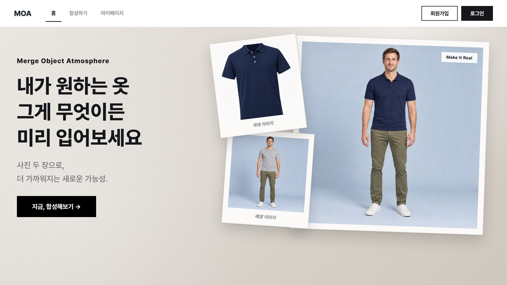

<br>

`SAM2` · `AnyDoor` · `PyTorch` · `FastAPI` · `SQLite / MySQL` · `React + Vite` · `Docker`

</div>

---

## 1. 프로젝트 개요

상의 사진과 내 사진을 올리면, 내가 그 옷을 입은 모습을 AI가 합성해 구매 전에 미리 보여 주는 웹 서비스

- **배경**: 온라인 의류 구매는 직접 입어볼 수 없고 상품 사진과 설명에 의존
- **문제**: 모델 착용 사진과 내 모습이 달라 구매 후 반품·교환 발생, 시간과 배송비 부담
- **담당**: 팀장, 프로젝트 총괄 · 백엔드·DB · AI 이미지 처리 파이프라인 · 작업 대기열·GPU 자원 관리 · Docker 실행 환경
- **기능**
  - 상의 영역 추출: SAM2가 클릭한 곳의 옷 윤곽을 자동으로 오려 냄
  - 착용 합성: AnyDoor가 오려 낸 옷을 인물 사진의 지정 영역에 합성
  - 회원별 사진첩 보관

<details>
<summary><b>용어 풀이</b></summary>

<br>

| 용어 | 뜻 |
|---|---|
| 상의 사진 | 입히고 싶은 옷이 나온 사진. 옷만 찍은 사진, 사람이 입은 사진 모두 가능 |
| 인물 사진 | 옷을 입혀 볼 본인 사진 |
| 영역 추출 | 사진에서 필요한 부분(옷 등)만 따로 오려 내는 것 |
| 포함 점 · 제외 점 | 사진 위 좌클릭이 포함 점(이 부분을 선택), 우클릭이 제외 점(이 부분은 빼기) |
| 마스크 | 추출한 영역을 흰색, 나머지를 검은색으로 나타낸 흑백 이미지 |
| 착용 영역 | 인물 사진에서 새 상의가 입혀질 부분 |
| 로그인 토큰 | 로그인하면 서버가 발급하는 임시 출입증 문자열. 요청마다 함께 보내 로그인 상태 확인 (유효 3시간) |
| 해시 | 원문 대신 되돌릴 수 없게 변환해 저장하는 값. 비밀번호와 로그인 토큰에 사용 |

</details>

### 1-1. 핵심 성과

| 항목 | 결과 | 상세 |
|---|---|---|
| 합성 시간 | 합성 1건 **15~20분 → 약 25초** (RTX 3080 10GB) | [6-1](#6-1-합성-시간-지연) |
| 경계선 노출 | 경계 밝기 차이 평균 **2.49 → 0.57**, 77% 감소 (100장) | [6-2](#6-2-재생성-영역-경계선-노출) |
| 서비스 구조 | 화면 · 웹 서버 · 모델 추론 서버 분리, Docker로 GPU PC 한 대에서 전체 서비스 실행 | [3장](#3-서비스-구조), [8장](#8-설치-및-실행) |

---

## 2. 합성 결과

<p align="center">
  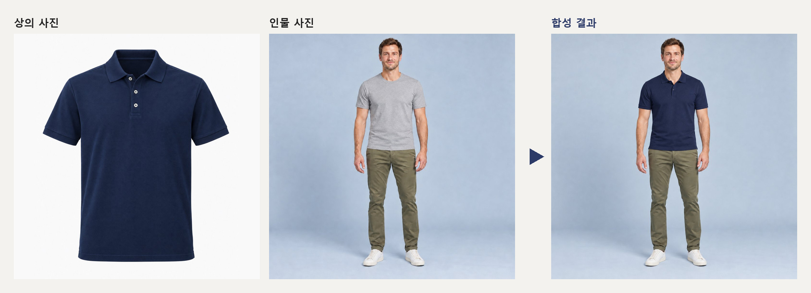
</p>

---

## 3. 서비스 구조

<p align="center">
  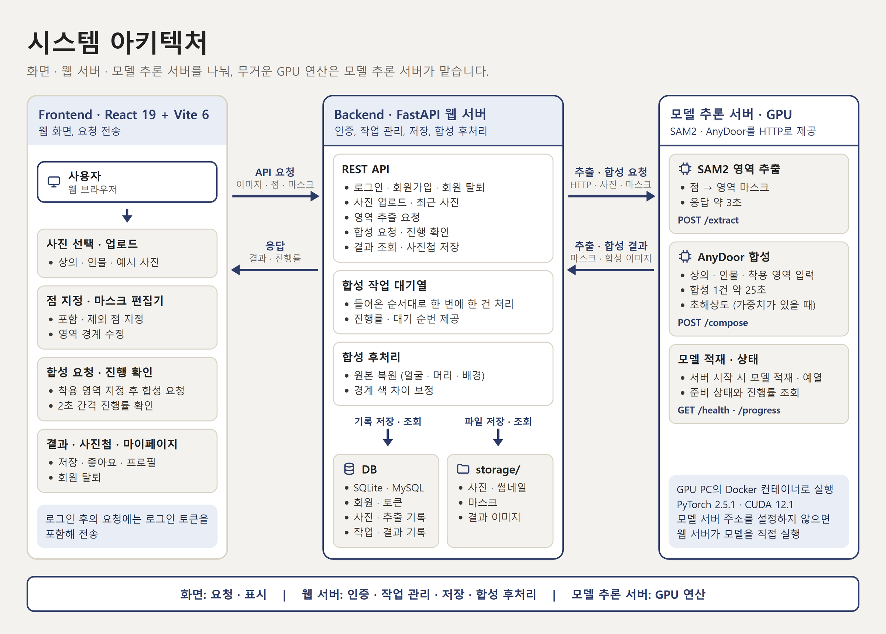
</p>

### 3-1. DB 관계도

<p align="center">
  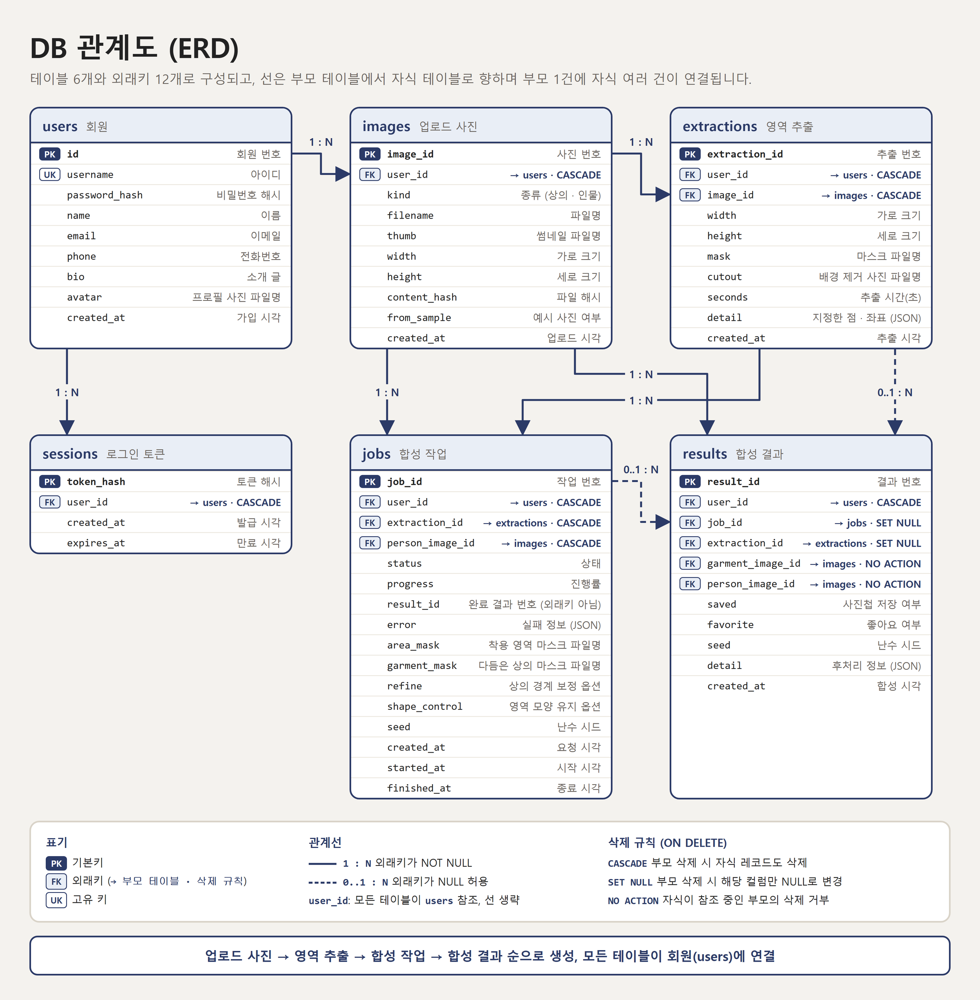
</p>

- 외래키(FK): 다른 테이블의 레코드를 가리키는 컬럼. 가리키는 쪽이 자식, 가리켜지는 쪽이 부모
- 전체 컬럼 설명: [docs/database.md](docs/database.md#5-테이블-구성)
- 삭제 규칙은 MySQL에서 적용. 기본 DB인 SQLite는 외래키 검사를 설정하지 않아 적용되지 않음

### 3-2. 데이터 저장 위치

- 정보는 DB 테이블, 사진·마스크·결과 이미지는 `storage/` 폴더에 저장 (테이블에는 파일명만 기록)

<details>
<summary><b>테이블별 저장 항목</b></summary>

<br>

| 구분 | DB 테이블 | 주요 컬럼 | `storage/` 파일 |
|---|---|---|---|
| 회원 | `users` | `username` 아이디, `password_hash` 비밀번호 해시, `email` 이메일 | `avatars/`: 프로필 사진 (256px 정사각형) |
| 로그인 토큰 | `sessions` | `token_hash` 토큰 해시, `expires_at` 만료 시각 (발급 후 3시간) | - |
| 업로드 사진 | `images` | `kind` 종류(상의·인물), `filename` 파일명, `from_sample` 예시 사진 여부 | `images/`: 원본, 썸네일 (JPG·PNG, 10MB 이하) |
| 영역 추출 결과 | `extractions` | `mask` 마스크 파일명, `cutout` 배경 제거 사진 파일명, `detail` 지정한 점 · 영역 좌표(JSON) | `extractions/`: 마스크, 배경 제거 상의 |
| 합성 작업 | `jobs` | `status` 상태, `progress` 진행률, `area_mask` 착용 영역 마스크, `refine` · `shape_control` 합성 옵션 기록 | `jobs/`: 착용 영역 마스크, 경계를 다듬은 상의 마스크 |
| 합성 결과 | `results` | `saved` 사진첩 저장 여부, `favorite` 좋아요 여부, `detail` 후처리 정보(JSON) | `results/`: 결과 사진, 미리보기 |

- 전체 컬럼: [backend/db.py](backend/db.py)
- 서버 기동 시 테이블 자동 생성. DB 연결 설정: [docs/setup.md 2. 설치](docs/setup.md#2-설치) 6단계
- 작업 대기열·진행 중 작업은 서버 메모리에서 처리, 진행 상태는 `jobs`에도 기록. 서버 재시작 시 처리 중이던 작업은 `failed`
- 보관 기간: 업로드 사진은 24시간 뒤 "최근 사용한 사진" 목록에서만 제외(기록·파일 유지), 미저장 합성 결과는 24시간 뒤 결과 목록 조회 시 기록과 파일 삭제
- 결과 삭제: 사진첩에서 삭제하면 `results` 행과 결과 사진·미리보기 파일 즉시 삭제, 작업 기록 `jobs` · 업로드 사진 · 마스크 유지
- 회원 탈퇴: 해당 회원의 모든 테이블 기록과 `storage/` 파일 즉시 삭제, 예시 사진 원본 유지

</details>

---

## 4. 처리 흐름

### 4-1. 단계별 처리

<p align="center">
  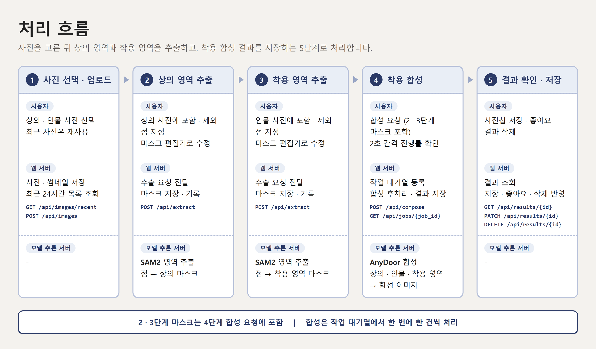
</p>

- API 요청 · 응답 · 오류 규격: [docs/api.md](docs/api.md)
- 로그인 연장 정책: [docs/login_extend.md](docs/login_extend.md)

### 4-2. 시퀀스 다이어그램

<details>
<summary><b>시퀀스 다이어그램 보기</b></summary>

<br>

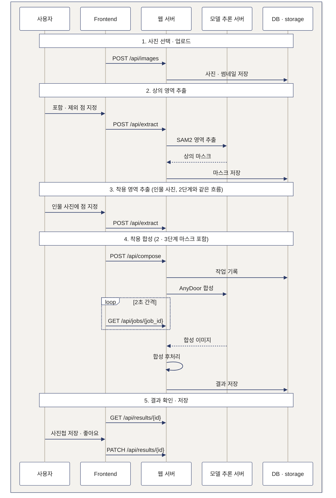

<details>
<summary><b>단계별 상세 시퀀스 (5개)</b></summary>

<br>

- 화살표 앞 번호는 진행 순서

**1. 사진 선택 · 업로드**

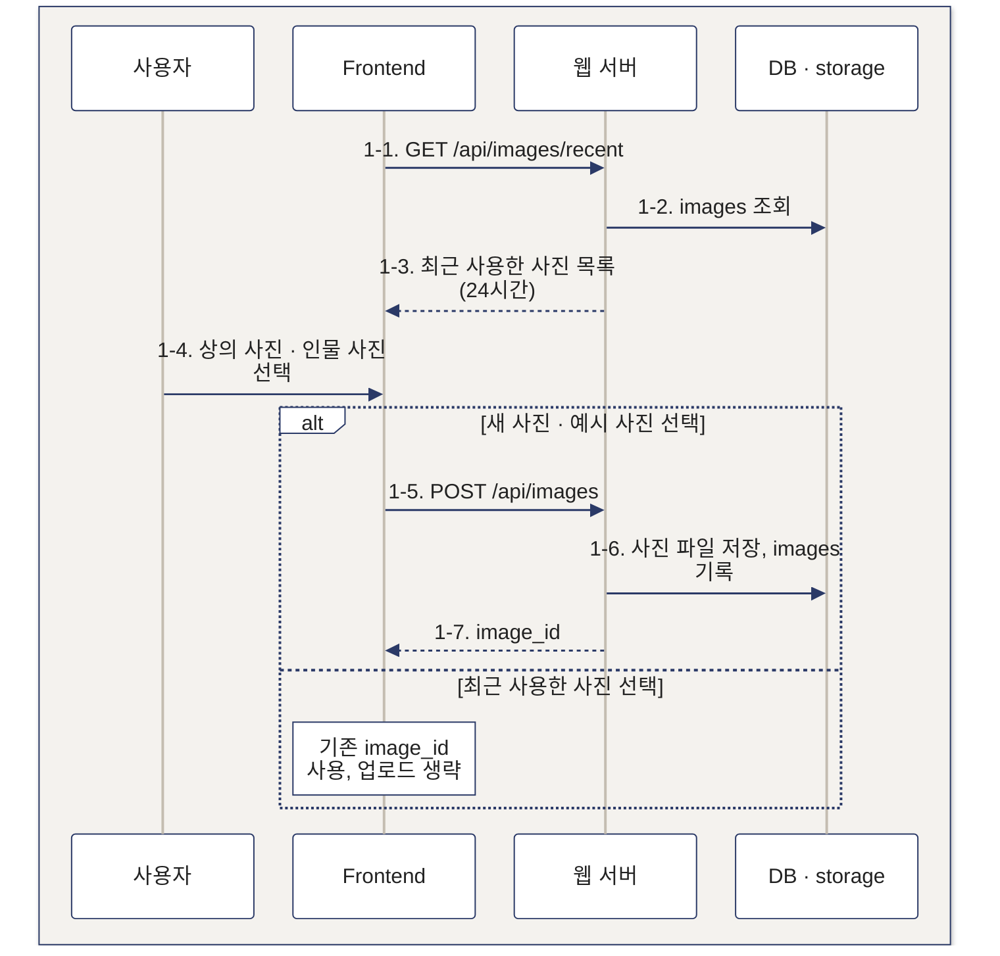

**2. 상의 영역 추출**

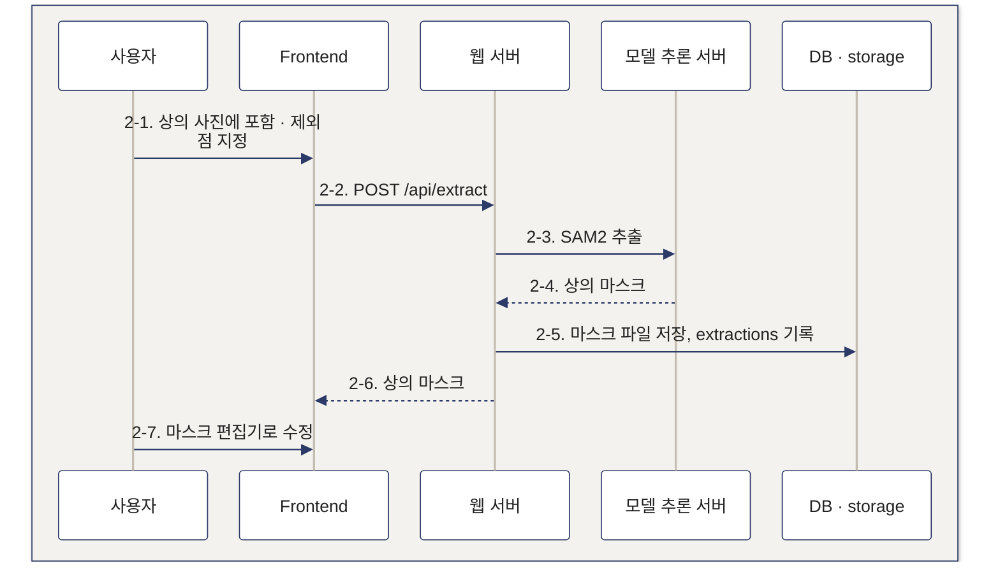

**3. 착용 영역 추출**

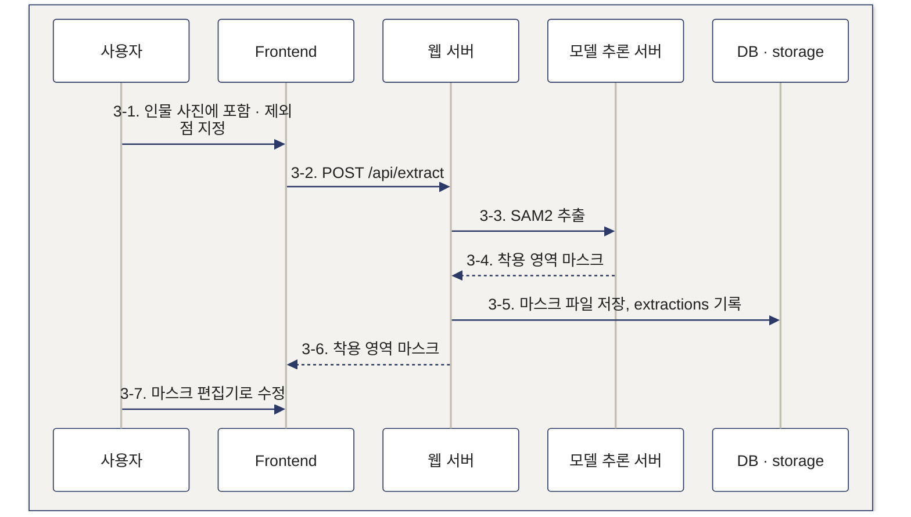

**4. 착용 합성**

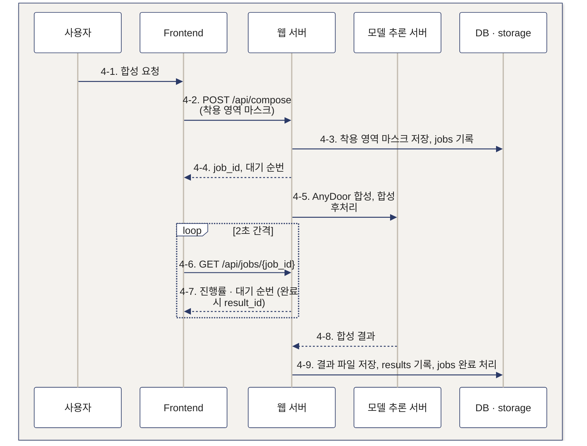

**5. 결과 확인 · 저장**

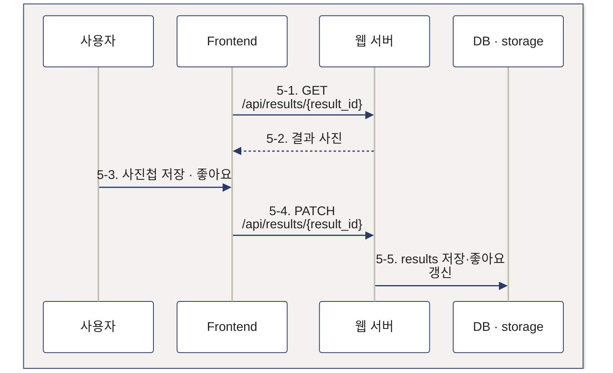

</details>

</details>

---

## 5. 기능

### 5-1. 상의 영역 추출 · SAM2

- 좌클릭 포함 점, 우클릭 제외 점으로 영역 지정
- 마스크 편집기: 영역 추가·제거, 마우스 휠 확대·드래그 이동으로 경계 수정
- 추출 응답 2.5~3초
- 상세: [features/object_extraction/README.md](features/object_extraction/README.md)

### 5-2. 착용 합성 · AnyDoor

- 합성 옵션 서버 고정: Reference Mask Refine 적용으로 상의 마스크 경계 다듬기, Shape Control 미적용으로 착용 영역을 감싼 사각형 재생성
- 작업 대기열에 쌓아 순서대로 처리, 진행률·대기 순번 표시
- 합성 응답 22~26초
- 합성 후처리 (환경 변수로 끄기 가능, 문제와 해결은 6-2 · 6-4 참고)
  - 원본 복원 `MOA_RESTORE_ORIGINAL`: 착용 영역 위쪽 얼굴·머리·배경의 원본 복원
  - seam 보정 `MOA_SEAM_FIX`: 재생성 영역 경계의 밝기·색 차이 보정
- 상세: [features/composition/README.md](features/composition/README.md)

### 5-3. 계정 · 사진첩 · 마이페이지

| 기능 | 내용 |
|---|---|
| 계정 | 회원가입·로그인·로그아웃·로그인 연장, 비밀번호 해시 저장, 토큰 인증 |
| 작업 기록 | 합성한 결과 목록. 저장하지 않은 결과는 24시간 보관 후 삭제, 저장한 결과는 사진첩에서 계속 확인 |
| 사진첩 | 전체·좋아요 탭, 날짜 필터, 최신순·오래된순 정렬, 크게 보기·다운로드·삭제 |
| 프로필 수정 | 사진·이름·휴대폰 번호·소개 글. 사진은 중앙 256px 정사각형 변환, EXIF(촬영 정보 등 사진 부가 정보) 제거 |
| 이메일 변경 | 현재 비밀번호 확인, 중복 이메일 차단 |
| 비밀번호 변경 | 현재 기기 로그인 유지, 다른 기기 로그인 만료 |
| 회원 탈퇴 | 현재 비밀번호 확인 후 회원 정보·로그인 토큰·업로드 사진·이미지 분할·이미지 합성 기록과 `storage/` 파일 전체 삭제, 합성 대기·진행 중에는 완료 후 탈퇴 |
| 설정 | 합성 완료 브라우저 알림 (이 브라우저에만 저장) |
| 고객센터 | 자주 묻는 질문 7개, 이메일 문의 연결 |

- 계정 API: [docs/api.md](docs/api.md#2-계정-관리-api)

---

## 6. 문제 해결

### 6-1. 합성 시간 지연

- **문제점**: AnyDoor 공식 설정 기준 RTX 3080 10GB에서 합성 1건(50스텝)에 15~20분 소요
- **원인**
  - 16.8GB 가중치 파일을 GPU 메모리(VRAM)로 바로 불러오는 구조, VRAM 10GB 초과
  - 부족분의 공유 GPU 메모리(시스템 메모리) 사용에 따른 연산 지연
- **해결 방법** (`features/composition/anydoor_composer.py`)
  - 가중치 파일을 시스템 메모리에서 연 뒤 필요한 가중치 약 9.2GB만 GPU에 적재
  - float16 혼합 정밀도 연산 적용
  - 서버 기동 시 예열 추론으로 첫 요청의 초기화 지연 제거
  - AnyDoor 구성 요소를 두 묶음으로 나눠 사용 중인 묶음만 GPU에 적재
- **결과**: 합성 1건 약 25초. 결과 화질 동일 (float32 결과 대비 평균 픽셀 값 차이 0.12~0.17, 픽셀 값 범위 0~255)

### 6-2. 재생성 영역 경계선 노출

- **문제점**: 합성 결과에 AnyDoor가 다시 그린 정사각형 영역의 테두리가 선 형태로 노출
- **원인**: 착용 영역 주변 정사각형을 다시 그려 원본에 붙이는 AnyDoor 구조, 다시 그린 배경과 원본의 밝기·색 차이
- **해결 방법** (`features/composition/seam.py`)
  - 테두리의 원본·결과 색 차이에서 이상값을 제외해 보정량 추정
  - 개선 포아송 방식으로 보정량을 영역 내부에 점진 반영
- **결과**: 100장 기준 경계 밝기 차이 평균 2.49에서 0.57로 77% 감소

### 6-3. 착용 사진의 인물 전체 추출

- **문제점**: 사람이 입은 상의 사진에서 상의에만 점을 지정해도 얼굴·머리를 포함한 인물 전체 추출
- **원인**: 점 1개만으로는 추출 대상이 모호, SAM2의 더 큰 객체(인물 전체) 선택
- **해결 방법**
  - 우클릭 제외 점 추가
  - 포함 점이 있는 연결 영역만 남기고 내부 구멍을 채우는 마스크 정리
  - 마스크 편집기로 경계 직접 수정
- **결과**: 착용 사진 평균 IoU 클릭 1회 0.77, 클릭 3회 0.86 (VITON-HD 인물·상의 사진 쌍 중 무작위 30쌍)
  - IoU: 정답 영역과 추출 영역의 교집합 ÷ 합집합, 1에 가까울수록 정확

### 6-4. 착용 영역 밖의 얼굴·배경 변형

- **문제점**: 합성 결과에서 착용 영역 밖의 얼굴·머리·배경까지 변형
- **원인**: 착용 영역을 감싼 정사각형 전체를 다시 그리는 AnyDoor 구조, 기본 정사각형 크기가 착용 영역의 1.5~2.9배 중 무작위
- **해결 방법** (`features/composition/restore.py`)
  - 정사각형 크기 1.3배 고정
  - 착용 영역 상단 경계 위쪽의 원본 복원 후처리, 새 상의 영역은 유지
- **결과**: 얼굴·머리·배경 원본 유지, 어깨선 잘림 방지

---

## 7. 프로젝트를 통해 얻은 교훈

- **공개 AI 모델의 적용:** 처음 접한 SAM 2와 AnyDoor의 구조와 동작을 이해하고, 직접 실행하며 웹 서비스에 적용
- **요구사항의 구체화:** 요구사항과 API 명세에 번호를 붙여 코드와 연결하고, LLM에는 구현 목적과 요구사항을 구체화해 전달한 뒤 생성된 코드의 적합성 검토
- **증상이 아닌 원인 해결:** 배경 잔상을 색 맞춤으로 덮지 않고, 원인인 AnyDoor의 영역 재생성 구조를 바탕으로 물체 기준 원본 복원 채택
- **측정과 비교에 기반한 결정:** 같은 입력으로 수정 전후와 여러 대안을 비교해 채택 여부 결정
- **범위 조정과 역할 합의:** 구현 결과가 초기 구상과 달라 멘토 조언으로 개발 범위를 조정하고, 팀원 간 역할과 참여 목적 합의
- **저장소 관리:** GitHub로 코드를 공유하고 PR로 병합하며, 점검 중 발견한 실수(개인 메모 업로드)는 즉시 조치

---

## 8. 설치 및 실행

- Docker로 한 번에 실행: NVIDIA GPU가 있는 PC 한 대에서 가중치 받기와 실행 명령 두 줄로 전체 서비스 실행, [local/README.md](local/README.md), 구성 설명: [docs/docker.md](docs/docker.md)
- Python 가상환경에 직접 설치하는 개발용 절차: [docs/setup.md](docs/setup.md)

| 항목 | 내용 |
|---|---|
| 운영체제 | Windows 64비트 (Windows 11 검증) |
| GPU | NVIDIA GPU (RTX 3080, GPU 메모리 10GB에서 검증) |
| PC 메모리 (RAM) | 32GB에서 검증 |
| 디스크 | 가중치 파일용 여유 공간 약 21.7GB |
| DB | SQLite 기본 사용, 별도 설치 불필요. 팀 공용 MySQL 구성: [docs/database.md](docs/database.md) |
| 지원 화면 크기 | 데스크톱 1440px, 모바일 375px 반응형 |
| 설치 오류 조치 | [설치 오류별 조치](docs/environment.md#2-설치-오류별-조치) |

---

## 9. 디렉터리 구성

```
CGI_MOA/
├── README.md
├── CLAUDE.md                        AI 코딩 도구 작업 규칙
├── requirements.txt                 Python 의존 패키지
├── Dockerfile · frontend.Dockerfile Docker 이미지 (backend, frontend)
├── docker-compose.yml · nginx.conf  Docker 실행 구성 (docs/docker.md)
├── frontend/                        React 웹 화면 (Vite)
├── backend/                         FastAPI 서버: DB 테이블 정의, API 라우터
├── features/                        AI 모듈: SAM2 영역 추출, AnyDoor 합성
├── model_server/                    GPU 모델 추론 서버와 Docker 구성
├── deploy/                          운영 서버 Docker 구성: 웹 화면·웹 서버·MySQL
├── local/                           한 PC 실행 Docker 구성: 웹 화면·웹 서버·MySQL·모델 추론 서버
├── scripts/                         단위 테스트, 환경 점검, 데이터 전처리, DB 이전, AnyDoor 재학습 (팀원 진행)
├── web/                             초기 정적 화면 시안 (AI·서버 미연동)
└── docs/                            문서 (10장 참고), readme/는 README 그림과 원본 (readme/src/)
```

### 9-1. 저장소 제외 항목

| 항목 | 내용 | 사유 |
|---|---|---|
| `checkpoints/` | 모델 가중치 | 대용량 |
| `storage/` | 업로드 사진, 합성 결과, SQLite DB | 사용자 데이터 |
| `backend/.env`, `frontend/.env.local` | DB 비밀번호 등 개인 설정 | 보안 |
| `Dataset/`, VITON-HD | 학습 데이터셋 | 대용량 · 연구용 라이선스 |
| `CGI/`, `venv/` | Python 가상환경 | 개인 환경 |

---

## 10. 관련 문서

| 목적 | 문서 |
|---|---|
| API · DB | [docs/api.md](docs/api.md), [docs/database.md](docs/database.md) |
| 설치 · 실행 | [docs/setup.md](docs/setup.md), [docs/docker.md](docs/docker.md), [local/README.md](local/README.md), [deploy/README.md](deploy/README.md) |
| 화면 · 서버 · AI 모듈 | [frontend](frontend/README.md), [backend](backend/README.md), [object_extraction](features/object_extraction/README.md), [composition](features/composition/README.md), [model_server](model_server/README.md) |
| 학습 · 환경 점검 | [scripts](scripts/README.md), [AnyDoor 재학습](scripts/retrain/README.md) (팀원 진행) |
| 작업 기록 · 규칙 | [최이재](docs/작업일지.md), [서지섭](docs/작업일지_서지섭.md), [CLAUDE.md](CLAUDE.md) |

---

## 11. 참고 자료

| 대상 | 출처 | 라이선스 | MOA 사용 범위 |
|---|---|---|---|
| AnyDoor | [ali-vilab/AnyDoor](https://github.com/ali-vilab/AnyDoor), [논문 arXiv:2307.09481](https://arxiv.org/abs/2307.09481) | MIT | 착용 합성 모델 코드·가중치 (커밋 `44ca2b2` 고정) |
| SAM 2 | [facebookresearch/sam2](https://github.com/facebookresearch/sam2) | Apache-2.0 | 상의·착용 영역 추출 모델 |
| DINOv2 | [facebookresearch/dinov2](https://github.com/facebookresearch/dinov2) | Apache-2.0 | AnyDoor가 상의 특징을 읽는 데 쓰는 모델 가중치 |
| VITON-HD | [shadow2496/VITON-HD](https://github.com/shadow2496/VITON-HD) | 연구용 | 추출 정확도 평가, AnyDoor 재학습 데이터. Repository 미포함 |

- AnyDoor는 [ControlNet](https://github.com/lllyasviel/ControlNet) 코드 기반

```bibtex
@article{chen2023anydoor,
  title={Anydoor: Zero-shot object-level image customization},
  author={Chen, Xi and Huang, Lianghua and Liu, Yu and Shen, Yujun and Zhao, Deli and Zhao, Hengshuang},
  journal={arXiv preprint arXiv:2307.09481},
  year={2023}
}
```

---

<div align="center">

### MOA

**내가 원하는 옷, 그게 무엇이든 미리 입어보세요.**

</div>
