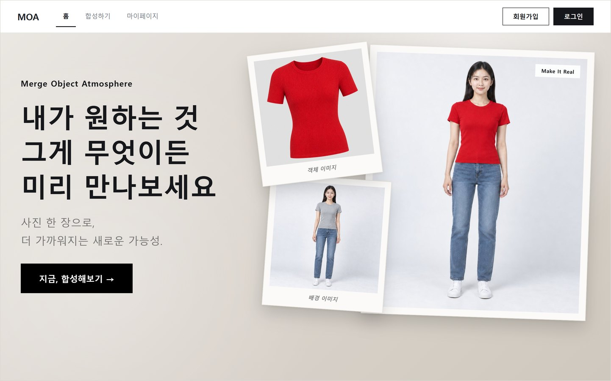
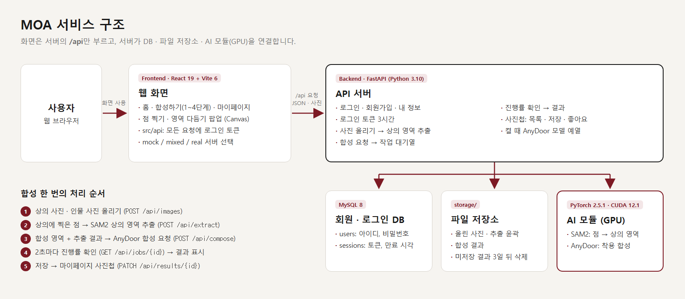
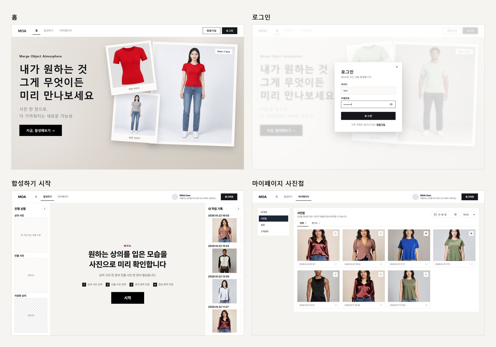
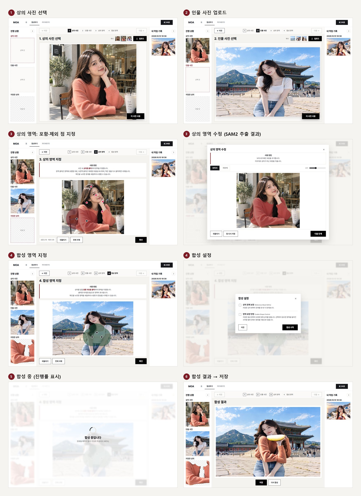
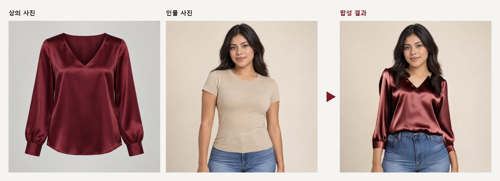

<div align="center">

# MOA

### AI 기반 상의 착용 합성 웹 서비스

상의 이미지와 인물 이미지를 선택하고 영역을 지정하면, AI가 인물에게 상의를 착용시킨 이미지를 생성하는 웹 서비스입니다.

**팀 프로젝트 · Frontend / Backend / AI**

`React + Vite` · `FastAPI` · `MySQL` · `SAM2` · `AnyDoor` · `PyTorch`

<br>



</div>

---

## 1. 프로젝트 개요

MOA는 **상의를 직접 착용하지 않고도 사용자 본인의 사진 위에서 착용 모습을 미리 확인할 수 있는 이미지 합성 웹 서비스**입니다.

사용자가 상의 이미지에 점을 지정하면 SAM2가 상의 영역을 분할하고, 인물 이미지에서 착용 영역을 지정하면 AnyDoor가 해당 위치에 상의를 합성합니다. 생성 결과는 회원별 사진첩에 저장되어 언제든 다시 확인할 수 있습니다.

| 항목 | 내용 |
|---|---|
| **배경** | 오프라인 착용의 시간·공간·비용 제약, 기존 합성 도구의 부자연스러운 결과와 높은 편집 숙련도 요구 |
| **목표** | 이미지 선택부터 상의 분할, 착용 합성, 결과 보관까지 단일 웹 흐름으로 제공 |
| **기간** | 2026.09.28 ~ 2026.11.22 |
| **구성** | 4인 팀 프로젝트 |

### Tech Stack

| 영역 | 기술 |
|---|---|
| **Languages** | Python 3.10, JavaScript |
| **Frontend** | React 19, Vite 6, React Router 6 |
| **Backend / API** | FastAPI, Uvicorn |
| **AI / Computer Vision** | SAM2 `sam2.1_hiera_base_plus`, AnyDoor: DINOv2 · ControlNet · Stable Diffusion 기반 |
| **Inference** | PyTorch 2.5.1 · CUDA 12.1, xformers, float16 혼합 정밀도 |
| **Database / Auth** | MySQL 8, SQLAlchemy, PyMySQL, 토큰 기반 인증 |

### 실행 환경 및 지원 범위

| 영역 | 범위 |
|---|---|
| Web | 데스크톱 1440px, 모바일 375px 반응형 화면 |
| AI 추론 | NVIDIA GPU 기반, RTX 3080 10GB 검증, 합성 시 PyTorch 최대 할당 메모리 8.25GB |
| 운영체제 | Windows 11 |
| 배포 | 로컬 개발 서버, Cloudflare Tunnel 기반 외부 시연 |

---

## 2. 서비스 구조

프론트엔드는 `/api` 단일 진입점으로만 통신하고, 백엔드가 데이터베이스·파일 저장소·GPU 추론 모듈을 통합합니다.

<p align="center">
  
</p>

| 구성 | 역할 |
|---|---|
| Frontend `frontend/` | React 기반 웹 화면. 모든 API 요청은 `src/api/` 계층에서 인증 토큰을 포함해 전송 |
| Backend `backend/` | FastAPI 서버. 인증, 이미지 업로드, 상의 분할, 합성 작업 큐, 결과·사진첩 관리 |
| AI 모듈 `features/` | `object_extraction`: SAM2 상의 영역 분할 / `composition`: AnyDoor 착용 합성 및 후처리 |
| MySQL | 회원 `users`, 인증 세션 `sessions`, 업로드 기록 `images` |
| `storage/` | 업로드 이미지, 분할 마스크, 합성 결과. 미저장 결과는 24시간 후 자동 삭제 |

---

## 3. 처리 흐름

| 순서 | 단계 | 내용 |
|---|---|---|
| 1 | 상의 이미지 업로드 | 합성 대상 의류 이미지 입력 |
| 2 | 인물 이미지 업로드 | 착용 대상 인물 이미지 입력 |
| 3 | 상의 영역 분할 | 포함·제외 점 프롬프트 기반 SAM2 분할, 마스크 보정 |
| 4 | 착용 영역 지정 | 인물 이미지 내 합성 위치 분할·보정 |
| 5 | 착용 합성 | 분할한 상의를 착용 영역에 AnyDoor로 합성, 후처리 적용 |
| 6 | 결과 저장 | 사진첩 저장, 좋아요·다운로드 |

### 합성 요청 흐름

```text
Frontend
  ↓ POST /api/images        상의·인물 이미지 업로드
  ↓ POST /api/extract       점 프롬프트 → SAM2 상의 마스크
  ↓ POST /api/compose       상의 마스크 + 착용 영역 → 합성 작업 등록
  ↓ GET  /api/jobs/{id}     2초 간격 진행률·대기 순번 조회
  ↓ GET  /api/results/{id}  합성 결과 조회
  ↓ PATCH /api/results/{id} 사진첩 저장 · 좋아요
Backend ↔ MySQL · storage/ · GPU
```

- 전체 API 요청·응답·오류 규격: [docs/api.md](docs/api.md)
- 인증 토큰 유효 시간 3시간, 연장 정책: [docs/login_extend.md](docs/login_extend.md)

---

## 4. 실제 구현 화면

### Web Service

<p align="center">
  
</p>

### 합성하기 단계별 화면

SAM2·AnyDoor 추론 서버와 연동한 실제 동작 화면입니다.

<p align="center">
  
</p>

### 합성 결과

<p align="center">
  
</p>

- 예시 이미지는 모두 AI 생성 이미지입니다.
- 캡처 일자: 2026-10-23, 실서버 연동 환경

---

## 5. 핵심 기능

### 상의 영역 분할 · SAM2

- 좌클릭 **포함 점**, 우클릭 **제외 점** 프롬프트 기반 상의 영역 분할
- 포함 점이 위치한 연결 영역 유지, 내부 구멍 보정 후처리
- **마스크 편집기**: 영역 추가·영역 제거 도구, 휠 확대·드래그 이동 기반 경계 보정
- 상세: [features/object_extraction/README.md](features/object_extraction/README.md)

### 착용 합성 · AnyDoor

- 착용 영역을 점 프롬프트로 분할한 뒤 마스크 편집기에서 보정
- 합성 옵션: Reference Mask Refine, Shape Control
- 비동기 작업 큐 기반 처리, 진행률·대기 순번 실시간 제공
- 추론 설정: DDIM 50스텝, 재생성 범위 1.3배 고정, float16 혼합 정밀도, 구성 요소별 GPU 순차 적재, 서버 기동 시 예열
- 후처리
  - 원본 복원: 착용 영역 상단의 얼굴·머리·배경을 원본으로 복원, `MOA_RESTORE_ORIGINAL`
  - 크롭 경계 seam 보정: AnyDoor 재생성 영역 경계의 밝기·색 불연속 보정, `MOA_SEAM_FIX`
- 상세: [features/composition/README.md](features/composition/README.md)

### 계정과 사진첩

- 회원가입·로그인·로그아웃, 비밀번호 해시 저장, 토큰 기반 인증
- 작업 이력 자동 보관: 저장한 결과는 사진첩으로 이동, 미저장 결과 24시간 후 자동 삭제
- 사진첩: 전체·좋아요 탭, 날짜 필터, 최신순·오래된순 정렬, 크게 보기·다운로드
- 상단 메뉴: 로그인 사용자의 프로필 사진·이름·소개 글 표시

### 마이페이지

- 내 정보: 프로필 카드와 계정 설정 탭 통합 구성
- 계정 설정
  - 프로필 수정: 프로필 사진·이름·휴대폰 번호·소개 글. 프로필 사진은 중앙 정사각형 256px로 변환, EXIF 메타데이터 제거
  - 이메일 변경: 현재 비밀번호 기반 본인 확인, 중복 이메일 차단
  - 비밀번호 변경: 현재 기기 세션 유지, 타 기기 세션 일괄 만료
- 설정: 브라우저 로컬 저장
  - 알림: 합성 완료 시 비활성 탭 대상 브라우저 알림
  - 합성 기본값: Reference Mask Refine·Shape Control 초기 선택값
- 고객센터: 자주 묻는 질문 7개, 이메일 문의 연결
- API: [마이페이지 계정 API 명세](docs/api.md#2-7-프로필-수정-추가-제안)

---

## 6. 합성 속도 개선

AnyDoor 공식 설정 기준 RTX 3080 10GB에서 50스텝 합성 1건에 11~15분이 소요되었습니다. 동일 입력·동일 조건에서 단계적 최적화를 적용해 **약 25초**로 단축했습니다.

| 단계 | 변경 내용 | 합성 1건 소요 시간 |
|---|---|---|
| 공식 설정 | 기준 | 11\~15분, 스텝당 13\~18초 |
| CPU 메모리 경유 로드 | 16.8GB 체크포인트를 GPU에 직접 로드하며 발생한 VRAM 용량 초과 해소. CPU 메모리에서 로드한 뒤 가중치 약 9.2GB만 GPU 적재 | 2분 30초 ~ 3분 45초 |
| 혼합 정밀도 | 행렬 곱·합성곱·어텐션 연산에 float16 적용 | 약 48초 ~ 1분 |
| 서버 기동 시 예열 | 최초 추론의 GPU 초기화 구간을 서버 기동 시점에 선처리 | 첫 요청부터 동일 속도 |
| 구성 요소별 GPU 순차 적재 | 사용 중인 구성 요소 묶음만 GPU에 상주, 교체 시 해제 후 적재 | 약 25초 |

- 화질: float32 대비 float16 결과의 평균 픽셀 차이 0.12~0.17 / 255, 육안 식별 불가 수준. 순차 적재 전후 결과는 픽셀 단위 동일
- 서버 실측 2026-10-21: 요청부터 결과 수신까지 22\~26초, 7건. 이전 서버 기록 48\~98초

### 구성 요소별 GPU 순차 적재 · 2026-10-21

- 구조: AnyDoor 메모리 절약 모드는 네 구성 요소를 두 묶음으로 나누어 사용 중인 묶음만 GPU에 상주
  - 노이즈 제거 단계: U-Net · ControlNet
  - 전후 처리 단계: VAE · DINOv2
- 기존 방식의 병목
  - 모델 로드 시 네 구성 요소 약 9.2GB 일괄 GPU 적재
  - 묶음 교체 시 신규 묶음 적재 후 기존 묶음 해제 → 교체 시점마다 네 구성 요소 동시 상주
  - VRAM 10GB 용량 초과, 공유 GPU 메모리 최대 3.2GB 사용에 따른 합성 지연
- 개선 내용: `features/composition/anydoor_composer.py`
  - 대형 구성 요소 네 개를 CPU에 둔 상태로 모델 로드
  - 묶음 교체 순서를 기존 묶음 해제 → 신규 묶음 적재로 변경
  - 가중치 · 연산 방식 · AnyDoor 원본 코드 변경 없음
- 비교 조건: RTX 3080 10GB, 서버 종료 상태, 동일 입력과 seed, Reference Mask Refine 적용, 예열 → SAM2 분할 → 합성 2회

| 항목 | 기존 | 개선 |
|---|---|---|
| 합성 시간 1회 · 2회 | 41.1초 · 36.9초 | 25.4초 · 24.4초 |
| 합성 시간 평균 | 39.0초 | 24.9초, 36% 단축 |
| 모델 로드 · 예열 | 152.1초 | 100.8초 |
| PyTorch 최대 할당 메모리 | 9.70GB | 8.25GB |
| PyTorch 최대 확보 메모리 | 11.43GB | 9.22GB |
| 공유 GPU 메모리 최대 사용량 | 3,199MB | 218MB |
| 결과 이미지 | 기준 | 픽셀 단위 동일, 최대 차이 0 |

---

## 7. 검증 결과

| 항목 | 결과 |
|---|---|
| 환경 점검 `scripts/check_env.py` | 18 / 18 통과: 패키지 버전, GPU, 모델 파일, DB 설정 |
| 전체 흐름 | 로그인 → 이미지 선택·업로드 → 상의 분할 → 착용 합성 → 저장 → 사진첩 조회 |
| 외부 접속 | Cloudflare Tunnel 경유 외부망 모바일 기기에서 로그인·합성·마이페이지 전 기능 확인 |
| 상의 분할 응답 | 2.5~3초 |
| 착용 합성 응답 | 요청부터 결과 수신까지 22~26초 |
| SAM2 분할 정확도 | VITON-HD 테스트셋 무작위 30쌍, 클릭 1회 → 3회 평균 IoU: 상품 이미지 0.89 → 0.96, 착용 이미지 0.77 → 0.86 |
| 마이페이지 API · 10/20 | 정상·예외 22개 사례 모두 기대 응답 일치: 형식 오류 400, 중복 이메일 409, 비밀번호 변경 후 타 기기 토큰 401 |
| 마이페이지 화면 · 10/22 | 내 정보·사진첩·계정 설정 화면 전환, 크게 보기, 다운로드, 375px 폭 가로 스크롤 없음 |

- IoU: 정답 영역과 분할 영역의 교집합 ÷ 합집합, 1에 가까울수록 정확
- 검증 환경: Windows 11, RTX 3080 10GB. 착용 합성 2026-10-21, SAM2 정확도 2026-10-17 측정

---

## 8. 기술적 문제 해결

### 합성 1건 11~15분 소요

| 구분 | 내용 |
|---|---|
| 문제 | AnyDoor 공식 설정 기준 50스텝 합성 1건에 11~15분 소요 |
| 원인 | 16.8GB 체크포인트의 GPU 직접 로드로 VRAM 10GB 용량 초과, 공유 GPU 메모리 사용에 따른 연산 지연 |
| 해결 | CPU 메모리 경유 로드, float16 혼합 정밀도, 서버 기동 시 예열, 구성 요소별 GPU 순차 적재 단계 적용 |
| 결과 | 합성 1건 약 25초, 결과 화질 동등. 단계별 수치는 [합성 속도 개선](#6-합성-속도-개선) |

### 재생성 영역 경계의 seam

| 구분 | 내용 |
|---|---|
| 문제 | 합성 결과에 AnyDoor 재생성 영역의 정사각형 테두리가 선 형태로 노출 |
| 원인 | 착용 영역 주변 정사각형을 재생성해 원본에 붙이는 구조, 재생성 배경과 원본 사이의 미세한 밝기·색 차이 |
| 해결 | 테두리의 원본·결과 색 차이에서 이상값을 제외해 보정량을 추정하고, 개선 포아송 방식으로 영역 내부에 부드럽게 전파. `features/composition/seam.py` |
| 결과 | 100장 시험 기준 경계 밝기 차이 평균 2.49 → 0.57, 77% 감소 |

### 착용 이미지의 인물 전체 분할

| 구분 | 내용 |
|---|---|
| 문제 | 인물이 착용한 상의 이미지에서 상의에만 점을 지정해도 얼굴·머리를 포함한 인물 전체가 분할되는 사례 |
| 원인 | 단일 점 프롬프트의 모호성으로 SAM2가 상의보다 큰 객체인 인물 전체를 선택 |
| 해결 | 우클릭 제외 점 프롬프트 도입, 포함 점이 위치한 연결 영역만 유지하는 후처리, 마스크 편집기 기반 경계 보정 |
| 결과 | 착용 이미지 평균 IoU 클릭 1회 0.77 → 클릭 3회 0.86, VITON-HD 무작위 30쌍 |

### 착용 영역 밖의 얼굴·배경 변형

| 구분 | 내용 |
|---|---|
| 문제 | 합성 결과에서 착용 영역 밖의 얼굴·머리·배경까지 함께 변형 |
| 원인 | 착용 영역을 감싼 정사각형 전체를 재생성하는 AnyDoor 구조, 기본 재생성 범위 1.5~2.9배 무작위 |
| 해결 | 재생성 범위 1.3배 고정, 착용 영역 상단 경계 위를 원본으로 되돌리는 원본 복원 후처리, 새 상의 영역은 경계 위라도 합성 결과 유지 |
| 결과 | 얼굴·머리·배경의 원본 보존, 어깨선 잘림 방지. `features/composition/restore.py` |

---

## 9. 설치 및 실행

새 Windows PC 기준 설치 순서입니다. 코드 블록의 명령을 위에서부터 차례로 붙여 넣어 실행하면 설치가 끝납니다. 오류가 나면 [설치 오류별 조치](docs/environment.md#2-설치-오류별-조치)를 참고합니다.

- 필요 조건: Windows 64비트, NVIDIA GPU, 모델 파일 약 21.7GB를 저장할 디스크 여유 공간
- 검증 환경: RTX 3080 10GB, 메모리 32GB, Windows 11
- 회원 데이터 저장: 기본은 MySQL 설치가 필요 없는 SQLite 체험판. 팀 공용 MySQL 구성은 [MySQL 데이터베이스 구축](docs/database.md)

### 설치 1. NVIDIA 그래픽 드라이버

- PyTorch가 GPU로 모델을 실행하기 위한 드라이버. CUDA는 PyTorch에 포함되어 별도 설치 불필요
- https://www.nvidia.com/ko-kr/drivers/ 에서 그래픽 카드 모델에 맞는 최신 드라이버를 받아 설치 후 PC 재시작
- 확인: Windows PowerShell에서 `nvidia-smi` 실행, 오른쪽 위 `CUDA Version` 12.1 이상

### 설치 2. Git · Anaconda · Node.js

| 프로그램 | 용도 |
|---|---|
| Git | MOA 저장소·AnyDoor 코드 받기, SAM2 패키지 설치 |
| Anaconda | Python 3.10 전용 conda 환경 생성. Anaconda나 Miniconda가 이미 있으면 해당 줄 생략 |
| Node.js 24 | React 웹 화면 개발 서버 실행 |

Windows PowerShell에서 실행합니다. winget은 Windows 10·11에 기본 포함된 프로그램 설치 명령입니다.

```powershell
winget install -e --id Git.Git
winget install -e --id Anaconda.Anaconda3
winget install -e --id OpenJS.NodeJS.LTS --version 24.22.1
```

- 원본 사용 약관 동의를 묻는 경우 `Y` 입력
- 설치 후 열려 있는 PowerShell 창을 모두 닫기. 새 창에서 설치한 명령 인식

### 설치 3. 저장소 받기와 conda 환경 구축

시작 메뉴에서 **Anaconda PowerShell Prompt**를 실행합니다. 이후 모든 명령은 이 창에서 실행합니다.

```powershell
cd C:\
git clone https://github.com/Jenny5789/CGI_MOA.git
cd CGI_MOA
conda create -n CGI python=3.10 -c conda-forge --override-channels -y
conda activate CGI
```

- 저장소 위치: `C:\CGI_MOA`. 다른 위치를 쓰는 경우 경로에 한글·공백이 없는 폴더 권장
- conda 환경 `CGI`: MOA 전용 Python 3.10 실행 공간. PC의 다른 Python과 패키지 버전이 섞이지 않도록 격리
- `conda activate CGI` 후 명령 줄 앞 표시가 `(CGI)`로 바뀌면 정상. 창을 새로 열 때마다 `cd C:\CGI_MOA`, `conda activate CGI` 1회 실행

### 설치 4. Python 패키지

| 패키지 | 용도 |
|---|---|
| PyTorch 2.5.1, CUDA 12.1 빌드 | SAM2·AnyDoor를 GPU에서 실행하는 딥러닝 프레임워크 |
| SAM2 | 클릭 지점 기반 상의 영역 분할 |
| `requirements.txt` | AnyDoor 실행, FastAPI 서버, 데이터베이스 접속 패키지 |
| xformers | 어텐션 연산 최적화, 합성 속도 향상·GPU 메모리 절감 |

```powershell
python -m pip install --upgrade pip
python -m pip install torch==2.5.1 torchvision==0.20.1 --index-url https://download.pytorch.org/whl/cu121
python -m pip install "git+https://github.com/facebookresearch/sam2.git@2b90b9f5ceec907a1c18123530e92e794ad901a4"
python -m pip install -r requirements.txt
python -m pip install xformers==0.0.28.post3 --index-url https://download.pytorch.org/whl/cu124 --no-deps
python -c "import torch; print(torch.cuda.is_available())"
```

- 마지막 줄 결과 `True`: GPU 사용 가능
- 버전 고정 이유: SAM2 커밋과 xformers `--no-deps`는 설치한 PyTorch 2.5.1이 다른 버전으로 교체되지 않도록 고정
- `Failed to build the SAM 2 CUDA extension` 안내는 일부 후처리 가속만 제외, 분할 결과에 영향 없음

### 설치 5. AI 모델 준비

| 파일 | 모델 | 용도 | 크기 |
|---|---|---|---|
| AnyDoor 코드 | AnyDoor 공식 저장소 | 착용 합성 모델 코드 | - |
| `sam2.1_hiera_base_plus.pt` | SAM 2.1 Base+ | 상의 영역 분할 가중치 | 약 309MB |
| `epoch=1-step=8687.ckpt` | AnyDoor | 착용 합성 가중치 | 약 16.8GB |
| `dinov2_vitg14_pretrain.pth` | DINOv2 ViT-g/14 | AnyDoor 내부 상의 이미지 특징 추출 가중치 | 약 4.5GB |

```powershell
git clone https://github.com/ali-vilab/AnyDoor checkpoints\AnyDoor
git -C checkpoints\AnyDoor checkout 44ca2b2
New-Item -ItemType Directory -Force checkpoints\sam2, checkpoints\AnyDoor\checkpoints
curl.exe -L -o checkpoints\sam2\sam2.1_hiera_base_plus.pt https://dl.fbaipublicfiles.com/segment_anything_2/092824/sam2.1_hiera_base_plus.pt
curl.exe -L -o "checkpoints\AnyDoor\checkpoints\epoch=1-step=8687.ckpt" "https://huggingface.co/spaces/xichenhku/AnyDoor/resolve/main/epoch%3D1-step%3D8687.ckpt"
curl.exe -L -o checkpoints\AnyDoor\checkpoints\dinov2_vitg14_pretrain.pth https://dl.fbaipublicfiles.com/dinov2/dinov2_vitg14/dinov2_vitg14_pretrain.pth
(Get-Content checkpoints\AnyDoor\configs\inference.yaml) -replace 'path/epoch=1-step=8687.ckpt', './checkpoints/epoch=1-step=8687.ckpt' | Set-Content checkpoints\AnyDoor\configs\inference.yaml
(Get-Content checkpoints\AnyDoor\configs\anydoor.yaml) -replace 'path/dinov2_vitg14_pretrain.pth', 'checkpoints/dinov2_vitg14_pretrain.pth' | Set-Content checkpoints\AnyDoor\configs\anydoor.yaml
```

- `checkout 44ca2b2`: MOA 합성 모듈이 AnyDoor `run_inference.py`의 특정 코드 줄을 바꿔 실행하므로 같은 버전으로 고정. `detached HEAD` 안내는 정상
- 마지막 2줄: AnyDoor 설정 파일의 `path/...` 자리표시 경로를 받은 가중치 위치로 변경
- 가중치 다운로드가 중단된 경우 해당 `curl.exe` 줄만 다시 실행. 파일 크기 확인과 다른 받는 곳: [모델 파일 확인](docs/environment.md#3-모델-파일-확인)

### 설치 6. 접속 설정 파일

```powershell
New-Item -ItemType Directory -Force storage
Set-Content -Encoding ascii backend\.env "DATABASE_URL=sqlite:///storage/moa_trial.db"
Set-Content -Encoding ascii frontend\.env.local "VITE_API_MODE=mixed","VITE_API_TARGET=http://localhost:8000"
```

- `backend\.env`: 회원 데이터를 SQLite 파일 `storage\moa_trial.db`에 저장. 백엔드 첫 실행 시 파일과 테스트 계정 `test` / `test1234` 자동 생성
- `frontend\.env.local`: 웹 화면이 로그인·추출·합성 요청을 localhost:8000 백엔드로 전송
- 두 파일과 `storage/`는 `.gitignore` 등록 대상
- 팀 공용 MySQL을 쓰는 경우 첫 두 줄 대신 [MySQL 데이터베이스 구축](docs/database.md) 진행

### 설치 7. 설치 확인

```powershell
$env:ANYDOOR_DIR = "$PWD\checkpoints\AnyDoor"
python scripts\check_env.py
```

- 정상: `가상환경 CGI` 항목을 제외한 모든 항목 `[OK]`
- `가상환경 CGI` 항목: 점검 스크립트가 venv 방식만 인식해 conda 환경에서는 `[NG]` 표시. 실행 경로 끝이 `envs\CGI\python.exe`이면 정상
- `A matching Triton is not available` 경고: Windows에서 항상 출력되는 안내, 무시

### 백엔드 실행

Anaconda PowerShell Prompt, 저장소 최상위 디렉터리에서 실행합니다.

```powershell
conda activate CGI
$env:ANYDOOR_DIR = "$PWD\checkpoints\AnyDoor"
python -m uvicorn backend.main:app --port 8000
```

- `$env:ANYDOOR_DIR`: AnyDoor 폴더 위치 지정, 창을 새로 열 때마다 1회
- 모델 로드와 예열 약 2분
- 확인: http://localhost:8000/api/health 의 `status`가 `ok`이면 서버 실행, `warmup`이 `done`이면 합성 준비 완료
- API 테스트 페이지: http://localhost:8000/docs . 자물쇠 표시 API는 `POST /api/auth/login` 응답의 `token`을 Authorize 버튼에 입력 후 실행
- 환경 변수: [백엔드 환경 변수 목록](backend/README.md#3-환경-변수)

### 프론트엔드 실행

백엔드 창은 그대로 두고, 새 PowerShell 창의 저장소 최상위 디렉터리에서 실행합니다.

```powershell
cd frontend
npm install
npm run dev -- --port 5180 --strictPort
```

- `npm install`: 웹 화면 의존 패키지 설치, 최초 1회
- 접속: http://localhost:5180 → 테스트 계정 `test` / `test1234` 로그인
- `--strictPort`: 5180번 사용 중이면 다른 포트로 옮기지 않고 종료, 터널 주소와 불일치 방지

| 구성 | 포트 |
|---|---|
| 백엔드 FastAPI | 8000 |
| 프론트엔드 개발 서버 | 5180 |

### 외부 접속 · Cloudflare 터널

- 용도: 휴대폰·외부 PC 시연, 계정 없이 임시 주소 발급. localhost 실행만으로는 불필요
- 준비 사항: 백엔드·프론트엔드 실행

```powershell
winget install --id Cloudflare.cloudflared
cloudflared tunnel --no-autoupdate --url http://localhost:5180
```

- 첫 줄은 최초 1회, 설치 후 새 PowerShell 창에서 두 번째 줄 실행
- 실행 로그의 `https://….trycloudflare.com` 주소로 접속
- 백엔드 요청: 프론트엔드 개발 서버가 `/api`를 8000번으로 전달, 터널 하나로 전체 기능 사용
- 접속 허용: `frontend/vite.config.js`의 `allowedHosts`에 `.trycloudflare.com` 등록
- 주소 유지: 터널 창 종료 시 만료, 실행마다 새 주소

---

## 10. 디렉터리 구성

```
CGI_MOA/
├── README.md                        프로젝트 개요
├── docs/                            공용 문서
│   ├── api.md                       API 명세
│   ├── environment.md               개발 환경 참고: 오류별 조치, 패키지 버전
│   ├── pip_freeze.txt               Python 패키지 목록
│   ├── database.md                  MySQL 데이터베이스 구축
│   ├── login_extend.md              로그인 세션 연장 정책
│   └── readme/                      README 이미지
├── frontend/                        프론트엔드: React
│   ├── README.md                    프론트엔드 개요
│   └── .env.example                 백엔드 연결 설정 예시
├── backend/                         백엔드: FastAPI
│   ├── README.md                    백엔드 구성
│   └── .env.example                 데이터베이스 접속 설정 예시
├── features/                        AI 모듈: SAM2, AnyDoor
│   ├── object_extraction/README.md  상의 영역 분할 모듈: SAM2
│   └── composition/README.md        이미지 합성 모듈: AnyDoor, 원본 복원, 크롭 경계 seam 보정
└── scripts/README.md                AI 모듈 단위 테스트, 환경 점검 check_env.py
```

---

## 11. 관련 기술 문서

| 목적 | 참고 문서 |
|---|---|
| 설치 오류·패키지 버전 확인 | [environment.md](docs/environment.md), MySQL 구성: [database.md](docs/database.md) |
| 프론트엔드 개발 | [api.md](docs/api.md), [login_extend.md](docs/login_extend.md), [frontend/README.md](frontend/README.md) |
| API 사양 확인 | [api.md](docs/api.md), [backend/README.md](backend/README.md) |
| 로그인 오류 조치 | [DB 연결 오류별 조치](docs/database.md#4-오류별-조치) |
| AI 모듈 단위 테스트 | [scripts/README.md](scripts/README.md) |

---

## 12. 저장소 제외 항목

| 항목 | 내용 | 사유 |
|---|---|---|
| `CGI/` | Python 가상환경 | 개인 환경 |
| `checkpoints/` | 모델 가중치 파일 | 대용량 |
| `storage/` | 업로드 이미지, 합성 결과 | 사용자 데이터 |
| `backend/.env`, `frontend/.env.local` | DB 비밀번호 등 개인 설정 | 보안 |
| VITON-HD | 학습 데이터셋 | 연구용 라이선스 |

---

## 13. 향후 발전 방향

- **합성 품질**: 원본 복원 범위를 착용 영역·새 상의 영역 내부로 한정, 상의 이미지 속 포즈 영향을 줄이는 입력 전처리, 착용 영역 비율 가이드
- **품질 평가**: 특징 보존·자연스러움 지표 기반 30쌍 정량 평가
- **상의 특화 학습**: AI Hub 쉐이프리스 의류 데이터 기반 AnyDoor 추가 학습 검토
- **기능 확장**: 로그인 연장 안내, 사진첩 결과 삭제, 모바일 마스크 편집 지원
- **배포**: GPU 서버 기반 서비스 배포

---

<div align="center">

### MOA

**내가 원하는 것, 그게 무엇이든 미리 만나보세요.**<br>
사진 한 장으로 확인하는 새로운 착용 경험

</div>
