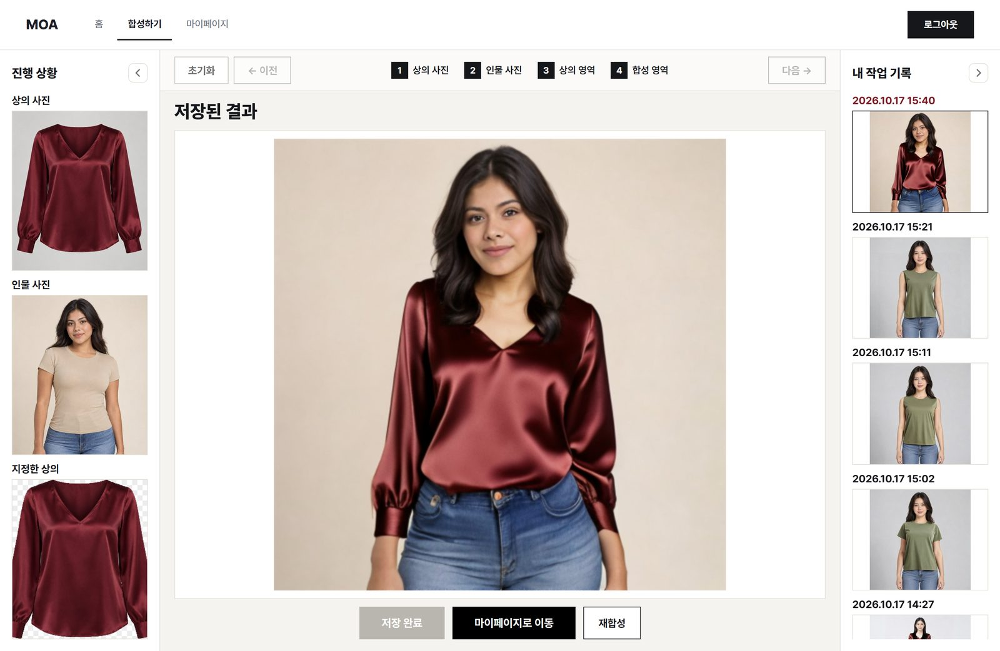
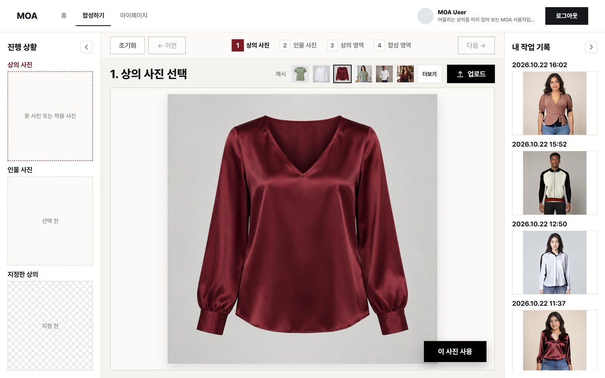
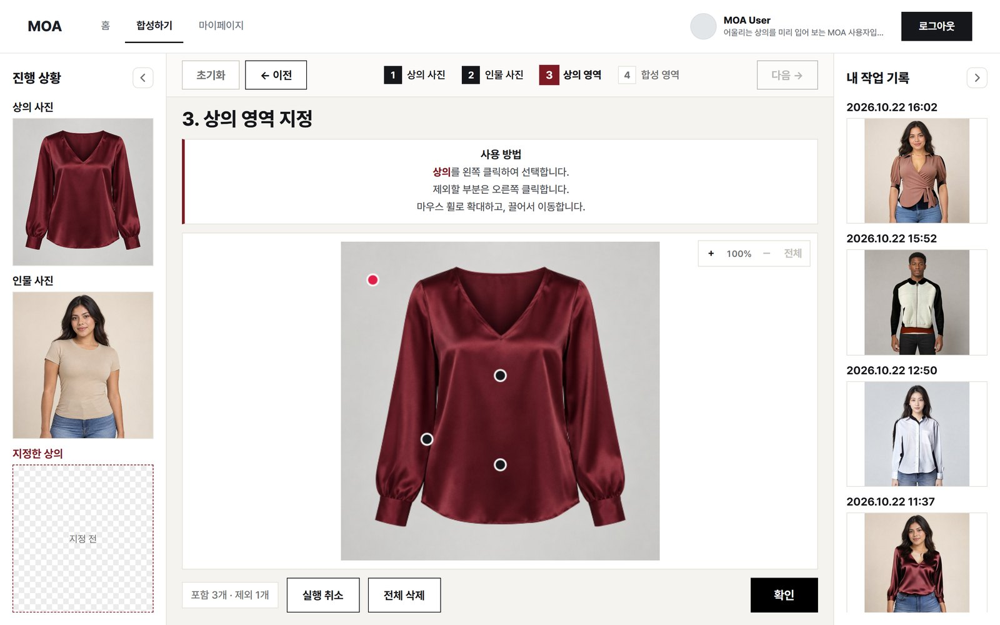
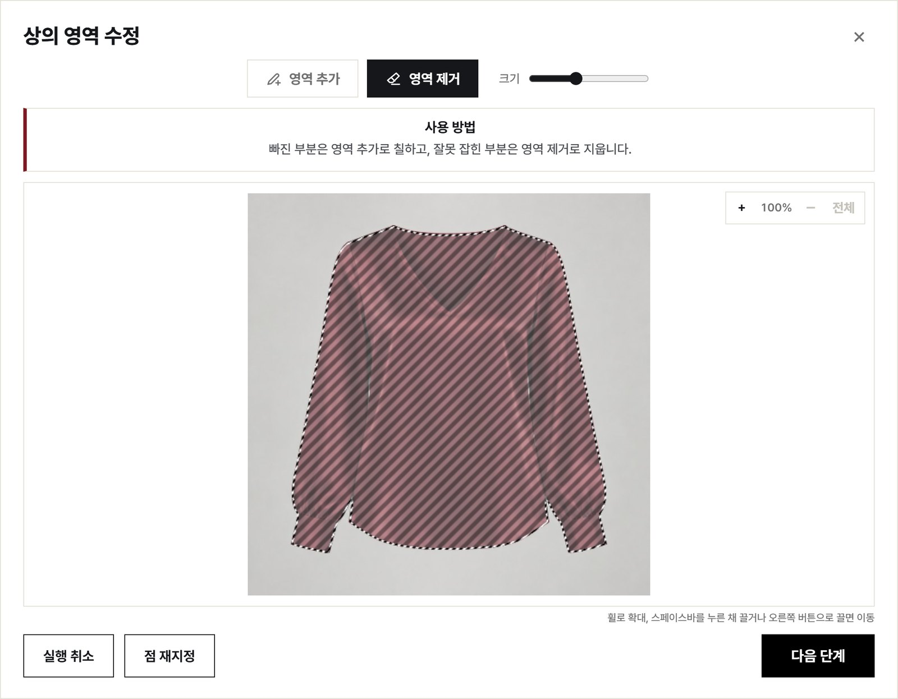
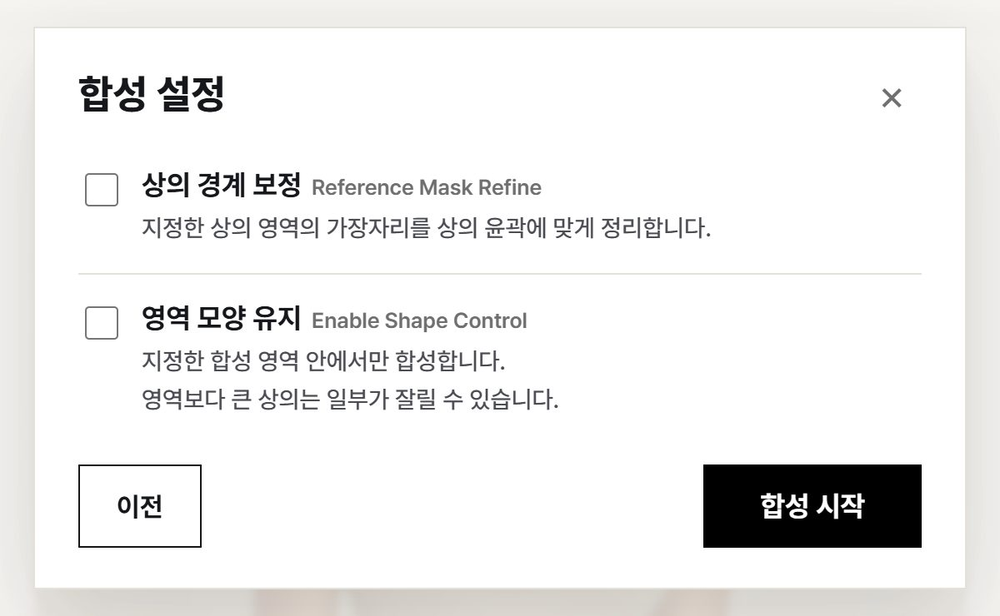
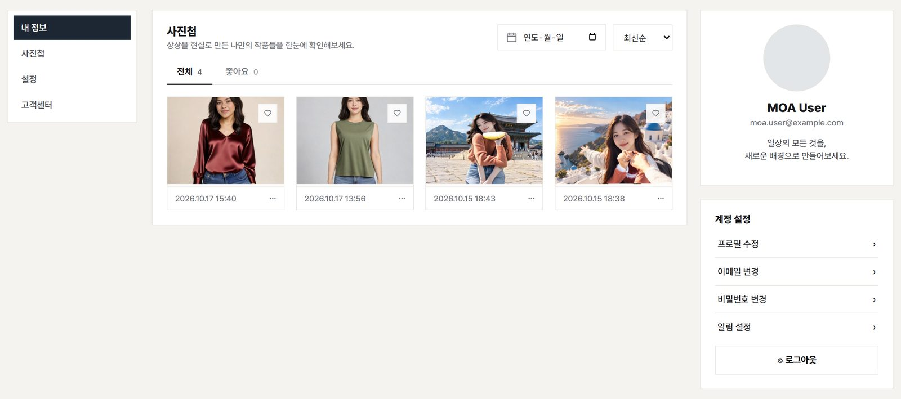

# MOA 웹 화면 (frontend)

상의 사진 한 장과 인물 사진 한 장으로 그 상의를 입은 모습을 만드는 웹 화면입니다. React 19 + Vite 6으로 만들었고, 서버(`backend/`)에 API로 요청합니다.



---

## 1. 화면 구성

| 주소 | 화면 | 로그인 | 내용 |
|---|---|---|---|
| `/` | 홈 | 불필요 | 서비스 소개, 들어올 때 연출, 로그인·회원가입 창 |
| `/studio` | 합성하기 | 필요 | 1~4단계 합성, 내 작업 기록 |
| `/mypage` | 마이페이지 | 필요 | 사진첩·좋아요, 날짜·정렬, 크게 보기·다운로드, 프로필, 계정 설정, 설정, 고객센터 |

- 로그인 전에 합성하기·마이페이지를 누르면 로그인 창이 열린다. 창은 바깥을 눌러도 닫히지 않는다 (Esc, × 로 닫음)
- 회원가입: 아이디(12자 이하, 공백 없음, 중복 확인), 비밀번호(8자 이상, 숫자 포함)·확인, 이메일(형식 검사, 이메일 하나당 가입 1회)은 필수, 전화번호는 선택. 필수 칸은 굵게 + `*` 표시 (`src/auth/signupRules.js`)

## 2. 합성하기 흐름

화면은 왼쪽 **진행 상황**(고른 사진이 쌓임), 가운데 **단계 화면**, 오른쪽 **내 작업 기록**(합성한 결과 전체)으로 나뉜다. 양쪽 패널은 접을 수 있고, 접은 상태는 브라우저에 기억한다.

### 1단계 상의 사진 · 2단계 인물 사진



- 끌어다 놓기, 업로드 버튼, 예시 사진 중에서 고른다. 상의는 옷만 찍은 사진, 사람이 입은 사진 모두 된다
- 예시는 6장을 보여 주고, "더보기" 창에 전체 예시와 **최근 24시간 동안 올린 사진**(최근 사용한 사진)을 함께 보여 준다. 최근 사진을 고르면 다시 올리지 않고 서버의 사진 번호를 쓴다
- "이 사진 사용"을 누르면 서버에 올리고(명세 3-1) 다음 단계로 간다. 화면은 업로드를 기다리지 않는다

### 3단계 상의 영역 지정



- 상의 위를 왼쪽 클릭하면 포함 점, 오른쪽 클릭하면 제외 점. 찍힌 점을 다시 누르면 지운다 (실행 취소·전체 삭제)
- **마우스 휠로 확대**, 끌어서 이동, 휴대폰은 두 손가락으로 확대 (최대 6배, `src/studio/zoom.js`). 확대해도 점은 원본 사진 위치로 정확히 보낸다
- "확인"을 누르면 점을 서버에 보내 SAM2로 상의 윤곽을 찾고(명세 4-1, 약 2.5초) 다듬기 창을 연다



- 다듬기 창(`src/studio/MaskEditor.jsx`): 브러시로 빠진 부분을 칠하고 지우개로 잘못 잡힌 부분을 지운다. 크기 조절, 실행 취소
- 다듬기 창 확대: 휠·＋/－ 버튼으로 확대, 스페이스바를 누른 채 끌거나 오른쪽 버튼으로 끌면 이동, "전체"로 원래 크기. 브러시 크기는 화면 기준이라 확대할수록 경계를 가늘게 고칠 수 있다
- 선택 영역은 검정·흰 빗금과 움직이는 점선으로 표시한다 (채도 0이라 어떤 색 옷 위에서도 보임)
- 점을 바꾸지 않았으면 서버에 다시 묻지 않고 지난번에 다듬은 영역에서 이어서 한다

### 4단계 합성 영역 지정 · 합성

- 인물이 지금 입은 상의를 3단계와 같은 방식(점 → SAM2 → 다듬기)으로 지정한다. 이 영역이 새 상의가 들어갈 자리다
- 다듬기 다음에 합성 설정 창이 열린다



| 설정 | 서버 값 | 내용 |
|---|---|---|
| 상의 경계 보정 | `refine` | 3단계 상의 윤곽 가장자리를 보정 모델로 정리한 뒤 합성 |
| 영역 모양 유지 | `shape_control` | 지정한 영역을 감싼 사각형이 아니라 칠한 모양 안에서만 다시 그림 |

- "합성 시작"을 누르면 3단계에서 다듬은 상의 윤곽, 4단계 영역, 설정을 함께 보낸다(명세 5-1). 2초마다 진행률·대기 순번을 확인하고(5-2) 끝나면 결과를 받는다(5-3). 합성 중에는 모든 클릭을 막는다
- 걸리는 시간: 실제 서버에서 약 1분 (10/17 측정 56초, RTX 3080)

### 결과 · 내 작업 기록

- 결과 화면: 저장(사진첩에 넣음, 명세 6-2), 마이페이지로 이동, 재합성
- 합성이 끝나면 저장하지 않아도 오른쪽 **내 작업 기록** 맨 위에 붙는다. 저장하지 않은 결과는 서버가 24시간 뒤 지운다
- 기록을 누르면 결과를 보여 주고, 그 결과를 만든 **재료(상의·인물 사진, 상의 윤곽, 합성 영역, 설정)를 불러와 1~4단계를 채운다**(`GET /api/results/{id}/source`). "재합성"을 누르면 4단계로 가서 바로 다시 합성할 수 있다. 재료 파일이 없는 기록은 결과만 보여 주고 "신규 합성"으로 1단계부터 시작한다
- 상단 **초기화**: 고른 사진·점·영역·결과를 지우고 시작 화면으로 (확인 창). 내 작업 기록과 합성 설정은 그대로

### 마이페이지



- 저장한 결과만 보인다. 전체·좋아요 탭, 날짜 선택, 최신순·오래된순. 바꿀 때마다 서버에 다시 묻는다(명세 6-1)
- 사진 아래 **⋯ 메뉴**: 크게 보기, 다운로드. 크게 보기 창은 Esc·바깥 클릭으로 종료, 다운로드 파일명은 `MOA_20261020_1432.png` 형식
- 오른쪽 프로필 카드: `GET /api/me`의 프로필 사진·이름·이메일·소개 글. 소개 글이 없으면 기본 문구
- 주소 뒤 `#`로 가운데 화면을 바꾼다: 없음 내 정보, `#album` 사진첩, `#account-profile`·`#account-email`·`#account-password` 계정 설정 항목, `#settings` 설정, `#support` 고객센터
- **오른쪽 계정 설정**: `src/mypage/Settings.jsx`의 `AccountPanel`, 명세 2-7~2-10. 선택 항목 하나만 가운데 영역에 표시
  - 프로필 수정: 사진 변경·기본 그림 복원, 이름 20자·휴대폰 번호·소개 글 60자. 변경 항목만 전송
  - 이메일 변경: 새 이메일, 현재 비밀번호
  - 비밀번호 변경: 현재 비밀번호, 새 비밀번호, 새 비밀번호 확인. 변경 시 타 기기 로그아웃
  - 서버 응답의 내 정보로 프로필 카드 즉시 갱신
- **왼쪽 설정**: `ServiceSettings`. 계정과 무관한 브라우저 로컬 설정, 서버 전송 없음
  - 알림 설정: 합성 완료 알림 사용 여부. 사용 설정 시 브라우저 알림 권한 요청, 합성 완료 시점에 다른 탭 사용 중이면 알림 표시. `src/utils/notify.js`
  - 합성 기본 설정: 합성 설정 창의 상의 경계 보정·영역 모양 유지 기본값. 합성하기 화면 진입 시 적용. `src/utils/composeDefaults.js`
- **고객센터**: `src/mypage/Support.jsx`. 자주 묻는 질문 7개, 이메일 문의 링크. 링크를 누르면 제목·작성 항목이 채워진 메일 작성 창 열림, 예시 주소 teamcgi_moa@example.com은 발송되지 않는 예시용 도메인. 질문 주제는 사진 조건, 영역 재지정, 합성 시간, 결과 보관, 다운로드, 로그인 시간, 사진 부가 정보

## 3. 실행 방법

Node.js가 필요하다 (확인한 버전: Node 24, npm 11).

```
cd frontend
npm install
copy .env.example .env.local     # 처음 한 번. 서버 고르기는 4장
npm run dev
```

- 터미널에 나오는 주소(기본 http://localhost:5173)로 접속한다. 5173번이 쓰이고 있으면 `npm run dev -- --port 5180`
- `.env.local`을 바꾸면 `npm run dev`를 다시 켠다
- 기타: `npm run build`(배포용 `dist/` 만들기), `npm run lint`(코드 검사), `npm run preview`(만든 결과 미리 보기)

## 4. 서버 연결

`.env.local`의 `VITE_API_MODE`로 고른다.

| 값 | 쓰는 서버 | 시험 계정 | 쓰는 때 |
|---|---|---|---|
| `mock` (기본) | 가짜 서버(`src/api/mock.js`) | `test` / `test` | 서버 없이 화면만 볼 때 |
| `mixed` | `client.js`의 `REAL_ROUTES`에 있는 주소는 실제 서버, 나머지는 가짜 서버 (지금은 모든 기능이 실제 서버) | `test` / `test1234` | 평소 개발 |
| `real` | 모두 실제 서버 | `test` / `test1234` | 실제 서버만 시험할 때 |

- 화면은 `/api/...`로 요청하고, 개발 서버(`vite.config.js`)가 `VITE_API_TARGET`(기본 `http://localhost:8000`)으로 넘긴다. 서버 실행 방법은 맨 위 `README.md`
- 새 API를 붙일 때: `src/api/`에 함수, `client.js`의 `REAL_ROUTES`에 주소, `mock.js`에 같은 주소의 가짜 응답을 함께 넣는다. mixed 모드에서 `REAL_ROUTES`에 없는 주소는 가짜 서버로 간다
- 다른 곳에서 시연할 때 Cloudflare 임시 터널(`*.trycloudflare.com`)로 들어오는 접속을 허용해 두었다 (`vite.config.js`의 `allowedHosts`)
- 로그인 토큰은 요청마다 붙이고, 서버가 401을 주면 로그인 창을 다시 띄운다

## 5. 폴더·파일 구성

```
frontend/
├─ index.html
├─ vite.config.js           개발 서버, /api 넘기기, 터널 허용
├─ .env.example             서버 고르기 예시 (.env.local로 복사)
├─ public/assets/           홈·예시 이미지
├─ docs/images/             이 README의 화면 사진
└─ src/
   ├─ main.jsx, App.jsx     시작점, 주소별 화면, 로그인 필요한 화면 막기
   ├─ pages/
   │  ├─ Home.jsx           홈
   │  ├─ Studio.jsx         합성하기 (1~4단계, 결과, 작업 기록, 초기화)
   │  └─ MyPage.jsx         마이페이지: 내 정보·사진첩, 계정 설정, 설정, 고객센터 화면 전환
   ├─ mypage/
   │  ├─ Settings.jsx       계정 설정: 프로필·이메일·비밀번호, 설정: 알림·합성 기본 설정
   │  ├─ Support.jsx        고객센터: 자주 묻는 질문, 문의
   │  └─ PhotoTools.jsx     사진첩 ⋯ 메뉴, 크게 보기 창
   ├─ studio/
   │  ├─ canvas.js          그리기 도우미 (사진 맞추기, 점, 선택 영역 표시, 사진이 칸으로 날아가는 효과)
   │  ├─ zoom.js            3·4단계 확대·이동·두 손가락 확대
   │  └─ MaskEditor.jsx     다듬기 창: 브러시·지우개, 확대·이동
   ├─ auth/
   │  ├─ AuthContext.jsx    로그인 상태, 로그인 창
   │  ├─ SignupModal.jsx    회원가입 창
   │  └─ signupRules.js     아이디·비밀번호·이메일·전화번호 규칙 (서버와 같게)
   ├─ api/                  서버 요청 (화면은 여기 함수만 부름)
   │  ├─ client.js          모든 요청이 거치는 곳: 서버 고르기, 토큰, 401 처리
   │  ├─ mock.js            가짜 서버
   │  ├─ auth.js            로그인·회원가입·아이디 중복 확인·로그아웃
   │  ├─ studio.js          사진 올리기, 최근 사진, 추출, 합성, 진행, 결과, 결과 재료
   │  ├─ results.js         결과 목록, 저장·좋아요
   │  └─ me.js              내 정보, 프로필·사진·이메일·비밀번호 변경
   ├─ components/           위쪽 메뉴(TopNav), 페이지별 CSS 켜기(usePageStyle), 알림(useToast)
   ├─ data/generatedAssets.js  예시 이미지 목록
   ├─ utils/
   │  ├─ date.js            날짜 표시, 2026.10.17 15:40 형식
   │  ├─ download.js        결과 다운로드
   │  ├─ notify.js          합성 완료 브라우저 알림
   │  └─ composeDefaults.js 합성 기본 설정 저장·읽기
   └─ styles/               페이지별 CSS. 페이지마다 그 페이지 CSS만 켠다
```

## 6. 사용하는 API

명세는 `docs/api.md`. 함수는 모두 `src/api/`에 있다.

| 화면 | 함수 | 주소 | 명세 |
|---|---|---|---|
| 로그인·회원가입 | `login`, `register`, `checkUsername`, `logout` | `POST /api/auth/login`, `POST /api/auth/register`, `GET /api/auth/check-username`, `POST /api/auth/logout` | 2-1, 2-2, 2-6, 2-4 |
| 1·2단계 | `uploadImage`, `listRecentImages` | `POST /api/images`, `GET /api/images/recent` | 3-1, 3-2 |
| 3·4단계 | `extractGarment` | `POST /api/extract` | 4-1 |
| 합성 | `requestCompose`, `getJob`, `getResult` | `POST /api/compose`, `GET /api/jobs/{id}`, `GET /api/results/{id}` | 5-1, 5-2, 5-3 |
| 작업 기록 | `listResults`, `getResultSource` | `GET /api/results`, `GET /api/results/{id}/source` | 6-1, 6-4 |
| 저장·좋아요 | `updateResult` | `PATCH /api/results/{id}` | 6-2 |
| 프로필 | `getMe` | `GET /api/me` | 2-3 |
| 설정 | `updateProfile`, `uploadAvatar`, `resetAvatar` | `PATCH /api/me`, `POST`·`DELETE /api/me/avatar` | 2-7, 2-8 |
| 설정 | `changeEmail`, `changePassword` | `PATCH /api/me/email`, `PATCH /api/me/password` | 2-9, 2-10 |

- 사진 주소에는 서버가 붙여 준 열쇠(`?key=`)가 있어 ``에 그대로 쓴다. 열쇠는 3시간 뒤 만료되므로 최근 사진 목록은 "더보기"를 열 때마다 새로 받는다

## 7. 브라우저에 저장하는 값

| 이름 | 내용 |
|---|---|
| `moa_token`, `moa_token_expires` | 로그인 토큰, 만료 시각 (로그아웃·401 때 지움) |
| `moa_panel_left`, `moa_panel_right` | 합성하기 양쪽 패널 접힘 여부 |
| `moa_notify_compose` | 합성 완료 알림 사용 시 `1`. 브라우저 알림 권한이 기기별로 관리되어 서버 대신 브라우저에 저장 |
| `moa_compose_defaults` | 합성 기본 설정 `{ refine, shape }` |

## 8. 이미지

- `public/assets/generated/`: 홈·예시 사진. 모두 AI로 만든 이미지이고 실존 인물 사진은 없다
- 화면에서 쓰는 것은 웹용 JPG(+ `thumb/` 작은 사진)만 저장소에 올린다. 원본 PNG는 `.gitignore`로 제외
- 예시 목록은 `src/data/generatedAssets.js`

## 9. 확인한 것 (2026-10-17)

- 실제 서버 전체 흐름: 로그인 → 상의·인물 예시 선택 → 3단계 점 2개, SAM2 추출 5초 → 지우개 보정 → 4단계 → 합성 56초 → 저장 → 초기화 → 작업 기록에서 1~4단계 복원 → 재합성 → 마이페이지 사진첩
- Cloudflare 터널로 휴대폰·외부 PC 접속, 합성 포함 전체 흐름
- `npm run lint`, `npm run build` 통과
- 2026-10-20 마이페이지: 설정 저장 뒤 프로필 카드 즉시 반영, 서버 오류 문구 표시, ⋯ 메뉴·크게 보기, 다운로드할 결과 파일 응답 200, 계정 설정 항목별 화면·설정·고객센터 전환, 합성 기본 설정 저장, 휴대폰 폭 375px 가로 스크롤 없음

## 10. 남은 일

- 휴대폰: 다듬기 창 브러시가 동작하지 않고, 제외 점(오른쪽 클릭)을 찍을 방법이 없다
- 로그인 시간 연장: API 함수(`extendLogin`)는 있지만 화면에 연결하지 않았다 (`docs/login_extend.md`)
- 사진첩 결과 삭제: 명세 6-3이 미정이라 메뉴에 없다
